# ArteStudio — HackLab 2026

**Equipo:** ensalada · **Universidad:** UTN FRRe  
**Integrantes:** Ezequiel Maldonado, Philippe Maurel Garcete y Franco Sanchez  
**Desafío:** ArteStudio · **Categoría:** Web

## Vulnerabilidades principales

- **Broken Access Control:** desde la sesión autenticada de una cuenta, **/password/inicio** devuelve el hash asociado al email enviado, aunque pertenezca a otra cuenta.
- **Hashing débil de contraseñas:** el portal usa SHA-256 directo, sin sal, por lo que permite probar contraseñas fuera de línea.
- **MFA bypass por aceptación cruzada de TOTP:** un código generado para una cuenta propia se acepta en el desafío de segundo factor de otra cuenta.

# 01 / objetivo, acceso y reconocimiento

## El archivo del desafío

ArteStudio es un portal para artistas. El desafío pide obtener acceso que permita publicar en Música el archivo **cancion.mp3**; la cuenta con la que empezamos no pertenece al grupo privilegiado.

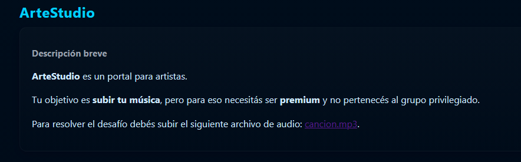

El MP3 dura unos 20 segundos y sus metadatos identifican a GISSIC TEAM. Lo escuchamos y revisamos con **file**, **ExifTool** y **ffprobe**. Esa inspección rápida no aporta una pista para evitar la restricción.

## Crear una cuenta propia

Desde **Registrarse** completamos el nombre artístico, el usuario, un email y una contraseña. El email debe permitirnos recibir y abrir el enlace de verificación; puede ser temporal si admite ese mensaje. Después verificamos la cuenta e iniciamos sesión.

En esta resolución, la cuenta propia se llama Fran (**@fran**); de aquí en adelante la llamaremos **cuenta de prueba**.

Desde la navegación del portal abrimos Música. La cuenta de prueba puede ver las obras, pero recibe el aviso **“Carga restringida”** al intentar publicar.

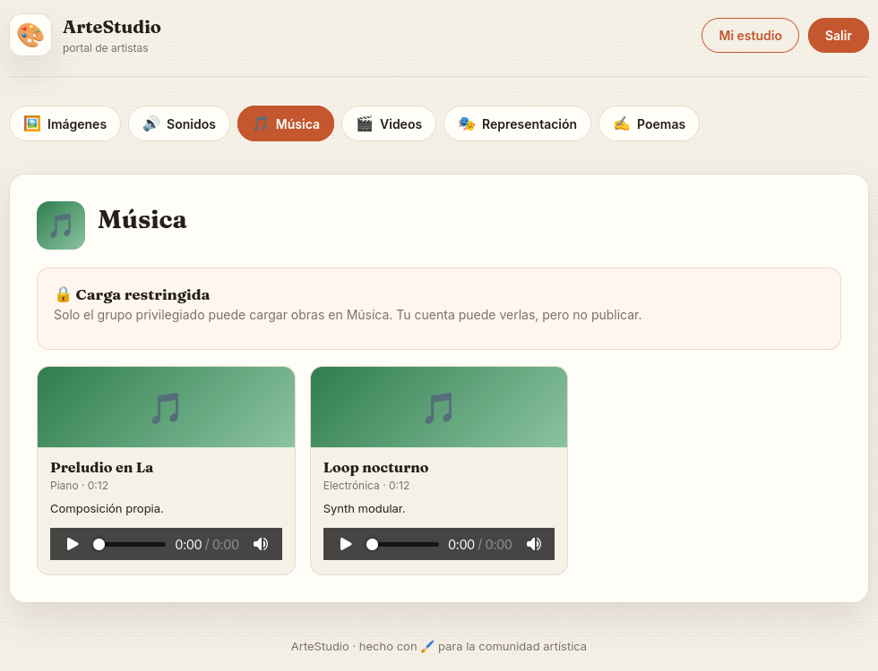

Volvemos a **Mi estudio** y abrimos **Configuración**. La tarjeta de la cuenta muestra el enlace a ese panel.

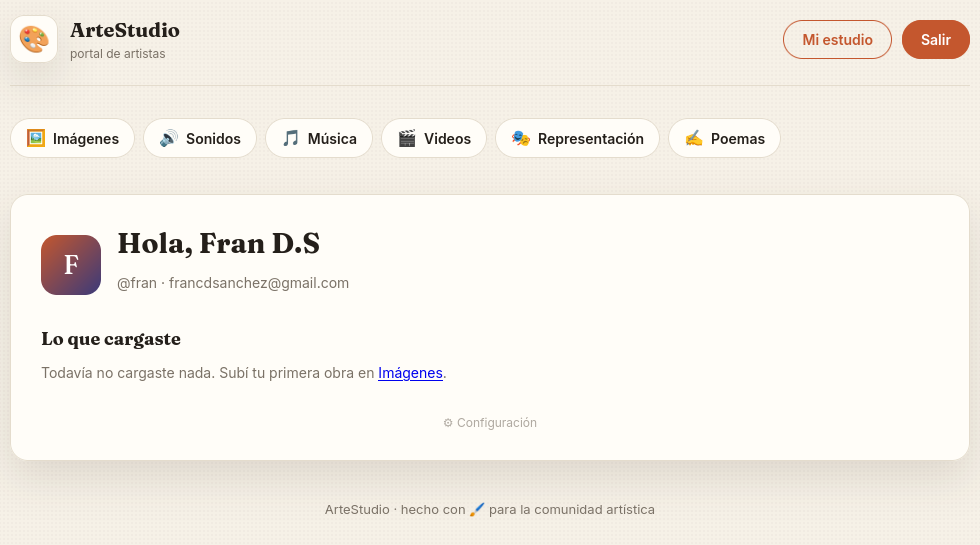

# 02 / explorar Configuración

## Revisar el formulario de contraseña

En **Configuración** revisamos el formulario de cambio de contraseña. El campo de email es editable; ese detalle será relevante al observar qué cuenta consulta la solicitud.

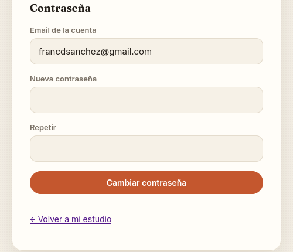

Con Burp observamos que la página carga **GET /static/password.js**. Estos fragmentos de los comentarios iniciales explican para qué se consulta el hash y aclaran que se envía el email escrito en el formulario:

~~~javascript
//   1) Se pide a /password/inicio el hash guardado de la cuenta (por email),
//      para poder comprobar en el front que la nueva sea distinta de la actual.
// (El email es editable: se envía el que esté en el campo.)
~~~

Este fragmento del manejador lee el email del formulario y envía la consulta a **/password/inicio**:

~~~javascript
const email = document.getElementById("pw-email").value.trim();
hashActual = (await pedirJSON(window.PW_INICIO, {email})).hash;
~~~

El navegador compara localmente el hash de la contraseña nueva con el hash recibido:

~~~javascript
if (await sha256Hex(nueva) === hashActual) {
  return aviso("La nueva contraseña no puede ser igual a la actual.", "error");
}
~~~

## Probar el flujo con la cuenta propia

Con Burp observando las solicitudes, completamos el formulario con una contraseña nueva y pulsamos **Cambiar contraseña**. La primera solicitud consulta el email de la cuenta de prueba en **/password/inicio**:

~~~http
POST /password/inicio
Cookie: <sesión autenticada de nuestra cuenta de prueba>
Content-Type: application/json

{"email":"francdsanchez@gmail.com"}

HTTP/2 200 OK
Content-Type: application/json

{"hash":"bd94dcda26fccb4e68d6a31f9b5aac0b571ae266d822620e901ef7ebe3a11d4f"}
~~~

Al comparar ese valor localmente con SHA-256 de la contraseña que nuestra cuenta de prueba tenía antes del cambio, **pass1234**, obtenemos el mismo resultado:

~~~bash
python -c "import hashlib; print(hashlib.sha256(b'pass1234').hexdigest())"
~~~

~~~text
bd94dcda26fccb4e68d6a31f9b5aac0b571ae266d822620e901ef7ebe3a11d4f
~~~

La coincidencia confirma que **/password/inicio** devuelve el SHA-256 directo de la contraseña de la cuenta indicada por email. Esto nos da una vía para investigar: si obtenemos el correo de una cuenta con permiso para publicar, podemos probarlo desde nuestra sesión autenticada. Si el servidor no verifica que el email corresponda a esa sesión, podría devolvernos el hash de esa cuenta y podríamos intentar recuperar su contraseña probando candidatos fuera de línea.

Después de la comparación, completamos el cambio de contraseña de nuestra cuenta de prueba.

## Activar y examinar la verificación en dos pasos

En **Configuración** de nuestra cuenta de prueba encontramos el bloque **Verificación de dos pasos (2FA)**, con el QR y el botón para activar la cuenta. Escaneamos el QR con una aplicación compatible con TOTP y activamos 2FA:

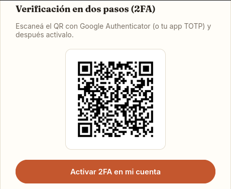

El portal confirma la activación:

Para leer el QR en nuestra máquina, guardamos la imagen en una ubicación local y, si tenemos **zbarimg** instalado, ejecutamos el comando con la ruta de ese archivo:

~~~bash
zbarimg --raw "RUTA/qr.png"
~~~

Al decodificar el QR de la captura obtenemos esta URI:

~~~text
otpauth://totp/ArteStudio:fran?secret=ARTESTUDIOSHAREDSECRET234567ABCD&issuer=ArteStudio
~~~

La URI etiqueta la entrada como **ArteStudio:fran**; **issuer** identifica el servicio y **secret** contiene la semilla. La etiqueta permite reconocer la entrada en la aplicación, pero no interviene en el cálculo: TOTP usa la semilla, la hora y los parámetros del algoritmo. Si dos cuentas comparten semilla y parámetros, generan el mismo código en el mismo intervalo.

Como alternativa a la aplicación, podemos generar un código vigente en nuestra máquina con PyOTP y el valor de **secret** obtenido del QR:

~~~bash
python -m pip install pyotp
python -c "import pyotp; print(pyotp.TOTP('ARTESTUDIOSHAREDSECRET234567ABCD').now())"
~~~

## Hipótesis

El QR de nuestra cuenta contiene **SHAREDSECRET** en el valor de **secret**. Esto plantea otra hipótesis: el portal podría reutilizar la semilla TOTP entre cuentas. Si fuera así, un código generado por nuestro autenticador podría aceptarse al verificar otra cuenta. Todavía necesitamos identificar un objetivo y comprobar ambas hipótesis.

# 03 / identificar una cuenta y su email

En **Poemas** encontramos **“Clave privada”**, firmado por Mister:

> «Lo que guardo no se comparte. O sí: basta una llave repetida, un mismo gesto para cada puerta, y lo privado deja de ser parte.»

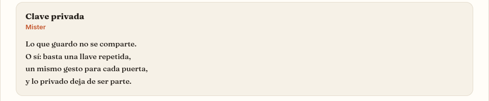

El poema llama nuestra atención sobre Mister y sugiere una “llave repetida”. La pista refuerza la hipótesis de que la semilla TOTP podría reutilizarse, aunque aún no sabemos si Mister tiene el mismo valor. El poema tampoco muestra su email. Para averiguar cómo consultar ese dato, exploramos **Representación** y expandimos la tarjeta de Bruno Tinta. Burp muestra que la página solicita **GET /representacion/bruno_tinta**:

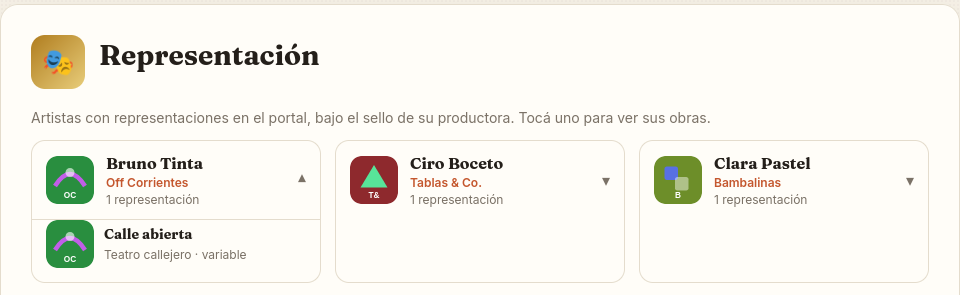

La respuesta de esa ruta incluye campos que no se ven en la tarjeta, entre ellos el email:

~~~http
GET /representacion/bruno_tinta

HTTP/2 200 OK
Content-Type: application/json

{"email":"bruno_tinta@artestudio.local","empresa":"Off Corrientes","nombre":"Bruno Tinta","obras":[{"titulo":"Calle abierta","desc":"Teatro callejero · variable"}],"usuario":"bruno_tinta"}
~~~

La consulta nos da un patrón para obtener los datos de detalle de un usuario. Lo probamos con **mister**, el usuario que nos llamó la atención en Poemas:

~~~http
GET /representacion/mister

HTTP/2 200 OK
Content-Type: application/json

{"email":"mister@artestudio.com.ar","empresa":null,"nombre":"Mister","obras":[],"usuario":"mister"}
~~~

# 04 / comprobar la hipótesis y recuperar la contraseña

Seguimos usando la sesión autenticada de nuestra cuenta de prueba. En Burp Repeater repetimos **POST /password/inicio**, conservamos la cookie de esa sesión y cambiamos únicamente el email del cuerpo por el que acabamos de obtener:

~~~http
POST /password/inicio
Cookie: <misma sesión autenticada de nuestra cuenta de prueba>
Content-Type: application/json

{"email":"mister@artestudio.com.ar"}

HTTP/2 200 OK
Content-Type: application/json

{"hash":"dcd79ebce907b98a97ac818318c9e467731e44068412590ea34280dcadcf02d9"}
~~~

La respuesta confirma que podemos consultar el hash asociado a otro email desde nuestra sesión.

Para intentar recuperar la contraseña, comparamos el hash con candidatos de una copia local de **rockyou.txt**. Hashcat calcula el SHA-256 de cada palabra y lo compara con el valor obtenido; usamos el modo **1400** para SHA-256 y **-a 0** para el ataque de diccionario:

~~~bash
hashcat -m 1400 -a 0 "dcd79ebce907b98a97ac818318c9e467731e44068412590ea34280dcadcf02d9" "RUTA/rockyou.txt"
~~~

La salida registrada para este hash confirma la coincidencia:

~~~text
dcd79ebce907b98a97ac818318c9e467731e44068412590ea34280dcadcf02d9:ronald
Status...........: Cracked
Hash.Mode........: 1400 (SHA2-256)
Recovered........: 1/1 (100.00%) Digests (total), 1/1 (100.00%) Digests (new)
~~~

La contraseña candidata es **ronald**; todavía falta comprobarla en el login del portal.

# 05 / iniciar sesión como Mister

Después de activar 2FA, cerramos la sesión de la cuenta de prueba. Iniciamos sesión una sola vez como Mister con **mister@artestudio.com.ar** y la candidata **ronald**. El primer factor responde con una redirección a **/login/2fa**:

~~~http
POST /login
Content-Type: application/x-www-form-urlencoded

email=mister%40artestudio.com.ar&password=ronald

HTTP/2 302 Found
Location: /login/2fa
~~~

La redirección crea una sesión pendiente del segundo factor. La conservamos en el navegador y continuamos desde el formulario; no volvemos a enviar el login.

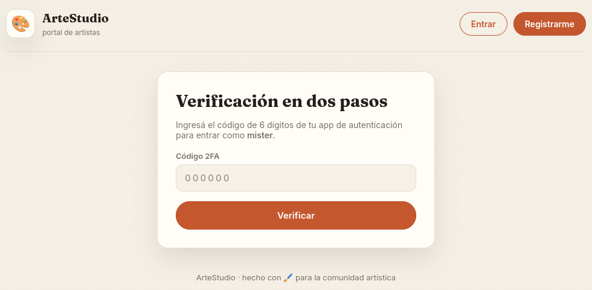

En la verificación en dos pasos de Mister ingresamos un código TOTP vigente generado por el autenticador de nuestra cuenta de prueba. La solicitud conserva la cookie de la sesión pendiente de Mister:

~~~http
POST /login/2fa
Cookie: <sesión pendiente de Mister>
Content-Type: application/x-www-form-urlencoded

codigo=<código TOTP vigente>

HTTP/2 302 Found
Location: /estudio
~~~

La página muestra **“¡Verificación en dos pasos correcta!”** y **“Hola, Mister”**, confirmando que completamos el acceso a su cuenta.

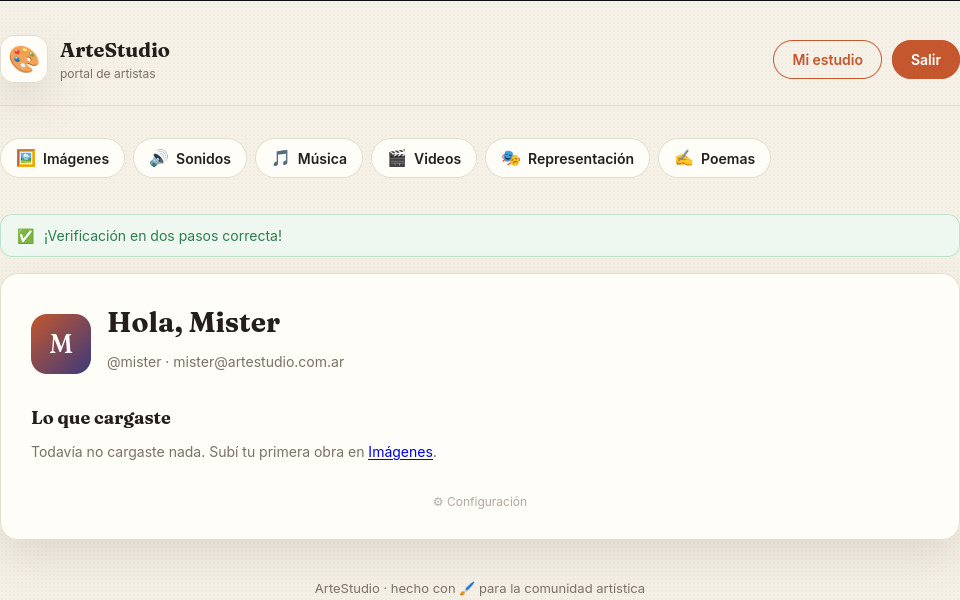

El portal aceptó en la verificación de Mister un código generado con el autenticador de nuestra cuenta de prueba. Esto demuestra el bypass del segundo factor entre cuentas. El código no contiene una identidad: el servidor debe validarlo contra la semilla asociada a la cuenta pendiente. Junto con **SHAREDSECRET** y la pista del poema, el resultado apunta a que el portal probablemente reutiliza la semilla TOTP.

# 06 / publicar el archivo del desafío

En Música, la sesión autenticada de Mister permite abrir **Cargar una obra**. La respuesta de **GET /c/musica** incluye el formulario **POST /c/musica/cargar**. Seleccionamos el archivo **cancion.mp3** del enunciado; el título y el subtítulo son valores libres y no cambian el resultado.

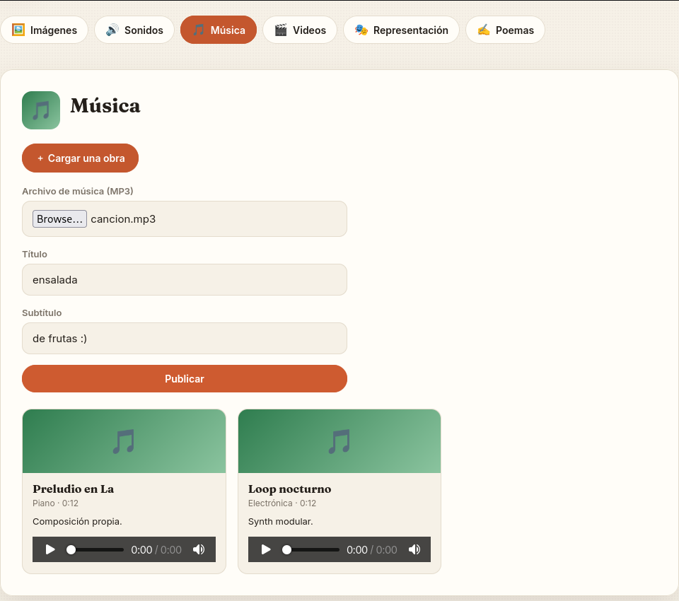

La canción aparece en la lista de Música; el portal también confirma la publicación y muestra la flag:

~~~text
e4ce96139449eb34a9cd02531b023ac9
~~~

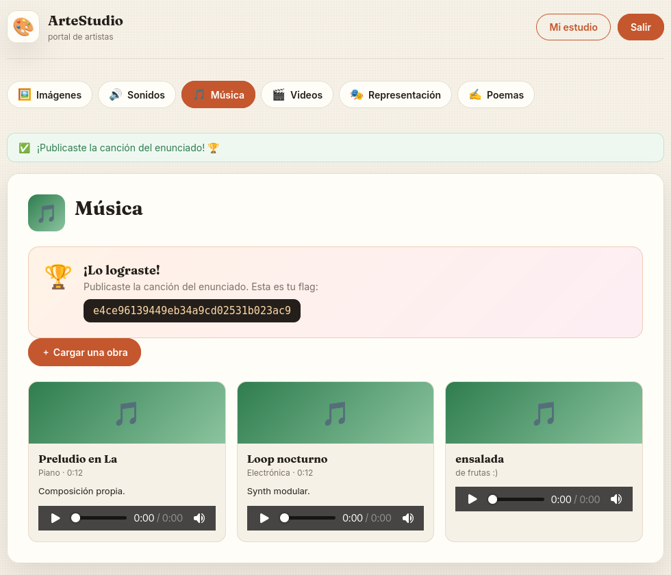

## Síntesis

La publicación fue posible al encadenar tres fallas: **/password/inicio** respondió con el hash del email solicitado, aunque no correspondiera a la cuenta autenticada; el SHA-256 directo permitió recuperar la contraseña de Mister con un diccionario; y el portal aceptó, en la verificación de Mister, un código TOTP generado con el autenticador de nuestra cuenta de prueba. La aceptación cruzada, junto con **SHAREDSECRET** y la pista del poema, apunta a que el portal reutiliza la semilla TOTP entre cuentas. Con la sesión de Mister publicamos **cancion.mp3** y obtuvimos la flag.

## Remediación recomendada

- **Contraseñas:** no devolver hashes al navegador ni permitir que el cliente elija por email qué cuenta consultar. Derivar la identidad de la sesión y validar y cambiar la contraseña en el servidor. Almacenarla con un esquema lento como Argon2id y una sal única por contraseña, en lugar de SHA-256 directo ([OWASP: Authorization](https://cheatsheetseries.owasp.org/cheatsheets/Authorization_Cheat_Sheet.html), [OWASP: Password Storage](https://cheatsheetseries.owasp.org/cheatsheets/Password_Storage_Cheat_Sheet.html)).
- **TOTP:** generar una semilla aleatoria y única para cada cuenta; asociar cada desafío pendiente a su cuenta y sesión, y comprobar el código solo contra esa semilla. Limitar intentos y vigencia, impedir la reutilización de códigos aceptados y proteger las semillas almacenadas ([OWASP: Multifactor Authentication](https://cheatsheetseries.owasp.org/cheatsheets/Multifactor_Authentication_Cheat_Sheet.html)).
