# Encuentro Obligado — HackLab 2026

**Equipo:** ensalada · UTN FRRe\
**Integrantes:** Ezequiel Maldonado, Philippe Maurel Garcete y Franco Sanchez\
**Categoría:** Condiciones de carrera

## 01 / contexto

**Descripción breve**

En tu proximo vuelo necesitas sentarte al lado de un CEO de una empresa muy importante. Tenés el dato que todavía no hizo el checkin, por lo que no seleccionó el asiento. El CEO es una persona muy desconfiada y seguramente siempre elegirá un asiento distante al tuyo (parece que tiene información interna de quién está en cada asiento). Tenés que buscar la manera de que no le quede otra opción y elija un asiento al lado tuyo.

Para hacer tu propio checkin contás con los siguientes datos:

- Código de checkin: ACK-129
- Apellido: BUSTAMENTE

Podés hacer que el propio CEO ingrese a hacer el checkin

Para que el CEO ingrese al sitio, ya tenés preparado un ataque de Ingeniería Social. Solo tenés que ingresar el dominio del desafío en el siguiente campo de texto (protocolo y dominio, sin path) y esto engañará al CEO y hará que ingrese a hacer el checkin y elegir su asiento. Aunque cuidado, porque solo podés hacerlo una vez por minuto. Esta funcionalidad no debe atacarse; es solo para obligar al CEO a ingresar al sitio.

Aviso: este recorrido supone que el CEO todavía no hizo check-in. La elección del asiento es definitiva. Si elegís otro asiento o convocás al CEO antes de bloquear las alternativas, tendrás que reiniciar la instancia y repetir el recorrido desde el comienzo.

## 02 / reconocimiento

Primero identificamos qué asientos siguen libres y qué operaciones permite el sitio.

En la página de ingreso vemos el formulario de check-in y, debajo, el recuadro “Información para su viaje” (Figura 1).

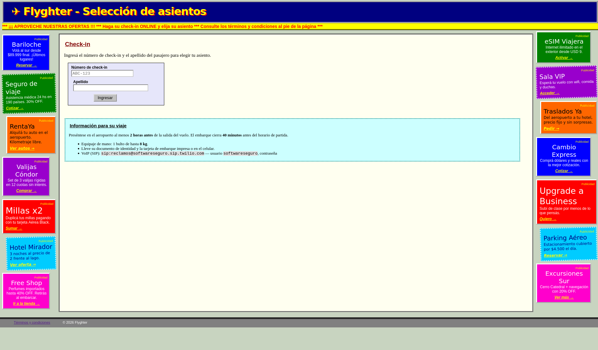

*Figura 1. Pantalla de ingreso al check-in.*

En el footer está el link a "Términos y condiciones" (Figura 2). Lo abrimos para ver las reglas del check-in.

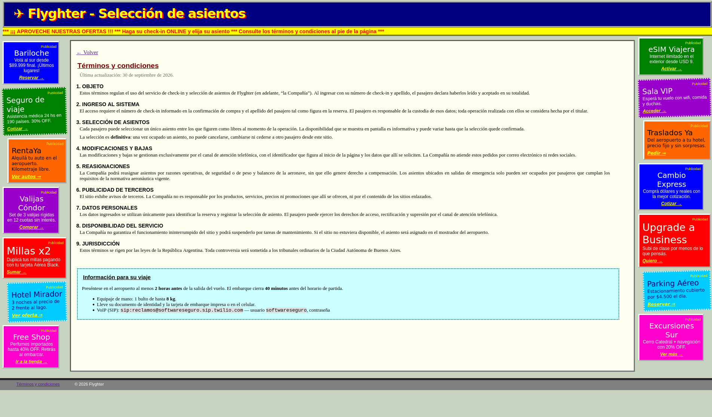

*Figura 2. Términos y condiciones del check-in, incluida la regla sobre la elección definitiva del asiento.*

La sección 3 establece que la elección de asiento es definitiva: desde el sitio no se puede cancelar, cambiar ni ceder un asiento ocupado. La sección 4 indica que las modificaciones y bajas se hacen por teléfono. Por ahora solo sabemos que ese canal existe; todavía no sabemos qué efecto tiene sobre los asientos.

Ingresamos con los datos de check-in del enunciado.

En el mapa de asientos (Figura 3), el verde marca los que están libres: 11, 17, 21, 22 y 27. El 21 y el 22 están juntos, por lo que debemos ocupar uno de los dos y el CEO el otro, y bloquear el resto (11, 17 y 27).

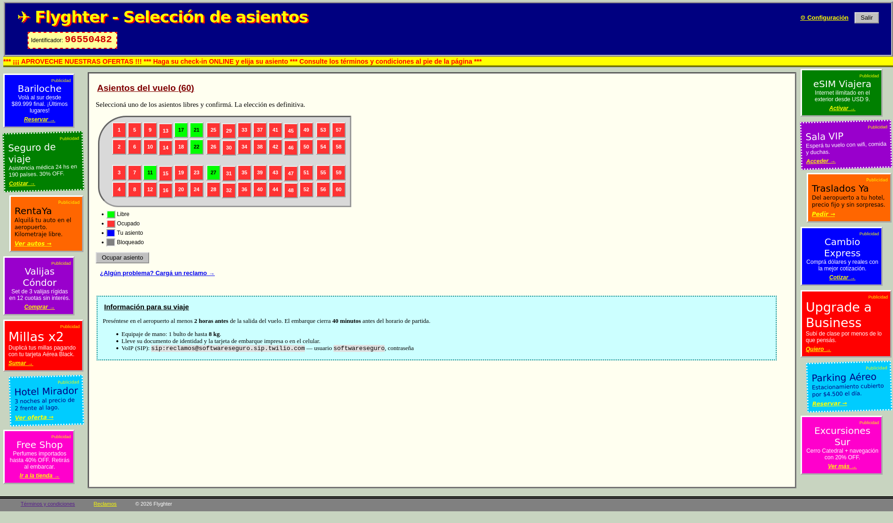

*Figura 3. Mapa de asientos disponible después del ingreso al check-in.*

## 03 / reclamos que aún no bloquean

Elegimos el asiento 21. (Figura 4).

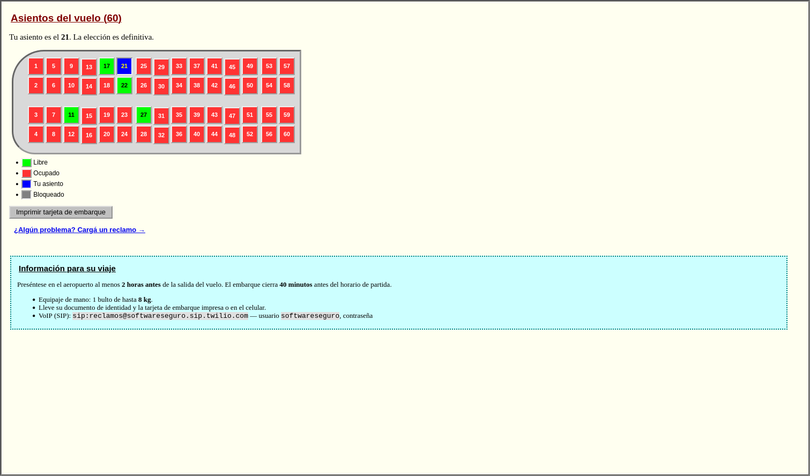

*Figura 4. Mapa de asientos después de escoger el asiento 21.*

En "Reclamos" encontramos un formulario que permite abrir hasta tres casos y los datos de una línea SIP para consultar su estado (Figura 5). Primero comprobamos qué efecto tiene crear un reclamo.

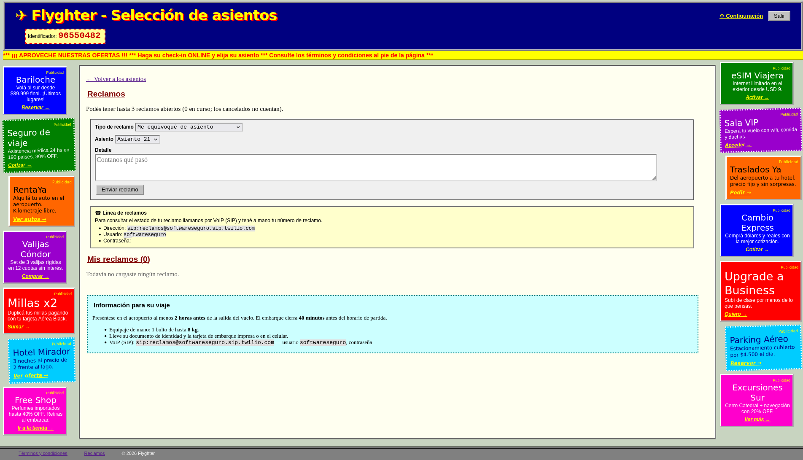

*Figura 5. Formulario de reclamos y datos de la línea SIP para consultar su estado.*

Al inspeccionar el envío del formulario de Reclamos, vemos que el número seleccionado viaja en un campo llamado `asiento`, aunque la interfaz solo ofrece nuestro asiento 21. Para comprobar si el servidor valida ese número, modificamos únicamente el valor de `asiento` antes de enviar la solicitud, conservando la misma sesión. Podemos interceptar la solicitud con Burp y cambiar el valor de 21 a 11, o modificar el formulario con DevTools.

Enviamos un reclamo de tipo «Me equivoqué de asiento» con `asiento` igual a 11. Al volver a la lista aparece un caso para el 11 en estado Pendiente (Figura 6). Esto demuestra que se registró el reclamo para ese asiento; todavía debemos consultar el mapa para saber si quedó bloqueado.

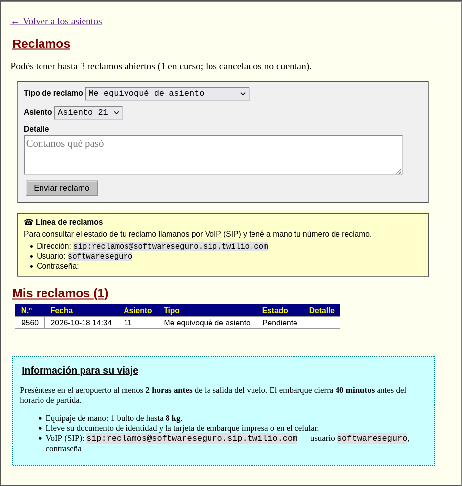

*Figura 6. Primer reclamo por el asiento 11, todavía en estado pendiente.*

Repetimos la solicitud para 17 y 27. Volvemos al mapa: 11, 17 y 27 siguen verdes (Figura 7), por lo que presentar reclamos para esos asientos no los bloquea.

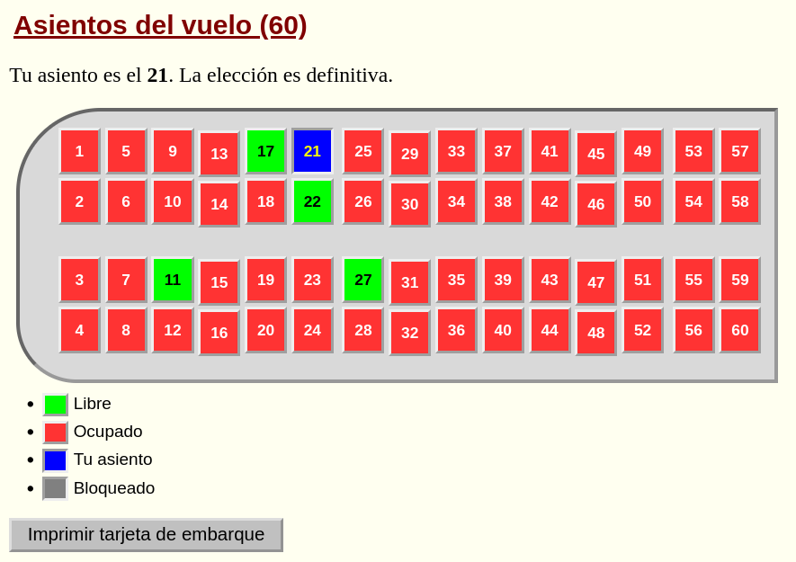

*Figura 7. Mapa en el que 11, 17 y 27 siguen libres después de presentar los reclamos.*

## 04 / del reclamo pendiente al bloqueo

Tenemos tres reclamos pendientes, pero los asientos siguen libres. Los términos indican que los cambios de asiento se hacen por teléfono y Reclamos publica la línea SIP. Podemos probar uno y después ver qué cambia en el reclamo y en el mapa.

Para iniciar la llamada necesitamos la dirección SIP (el destino) y el usuario y la contraseña SIP (para que acepten la conexión). Una vez conectados, el menú pide el Identificador numérico que mostró el sitio tras el check-in (Figura 8)  y la clave de cuatro dígitos creada en "Configuración" (Figura 9); con ellos reconoce nuestra sesión. Luego ingresamos el número del reclamo (Figura 6). El menú ofrece 1 (cancelar), 2 (evaluar) y 3 (hablar). Elegimos 2 porque queremos pedir la evaluación del reclamo.

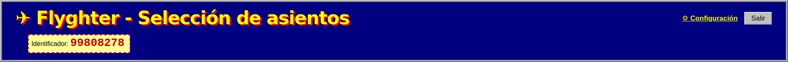

*Figura 8. Identificador mostrado en la cabecera de la cuenta.*

En "Configuración" creamos una clave telefónica de cuatro dígitos y comprobamos el mensaje "Cambios guardados" (Figura 9). Guardamos esa clave junto con el identificador que mostró el check-in.

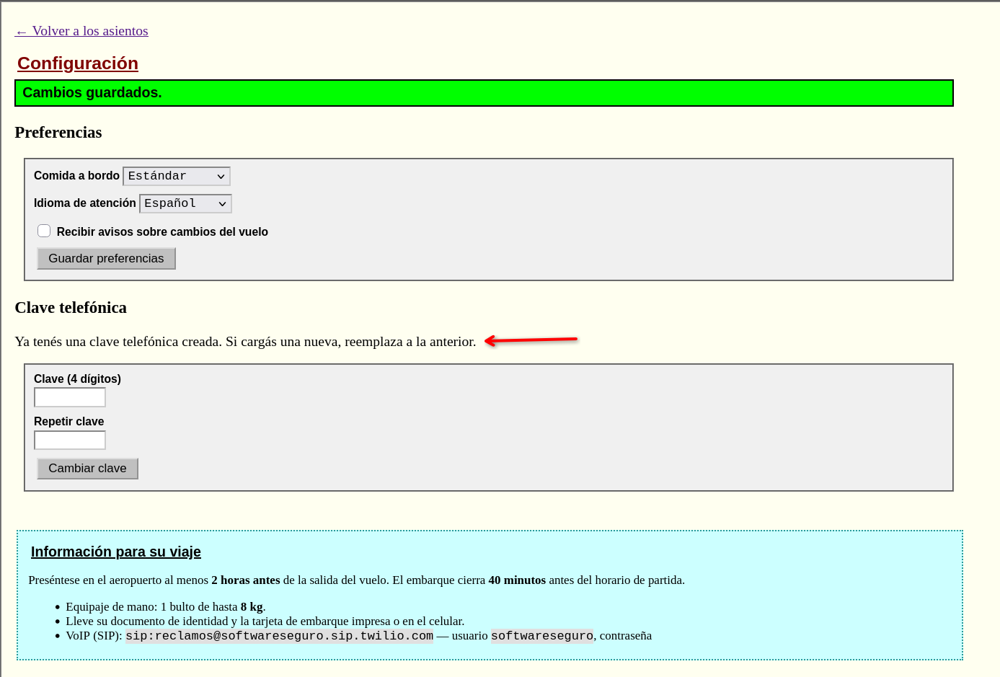

*Figura 9. Pantalla de configuración tras guardar la clave telefónica.*

En una llamada de prueba enviamos la opción 2 para un reclamo del asiento 11. La lista pasó de "Pendiente" a "En análisis" (Figura 10):

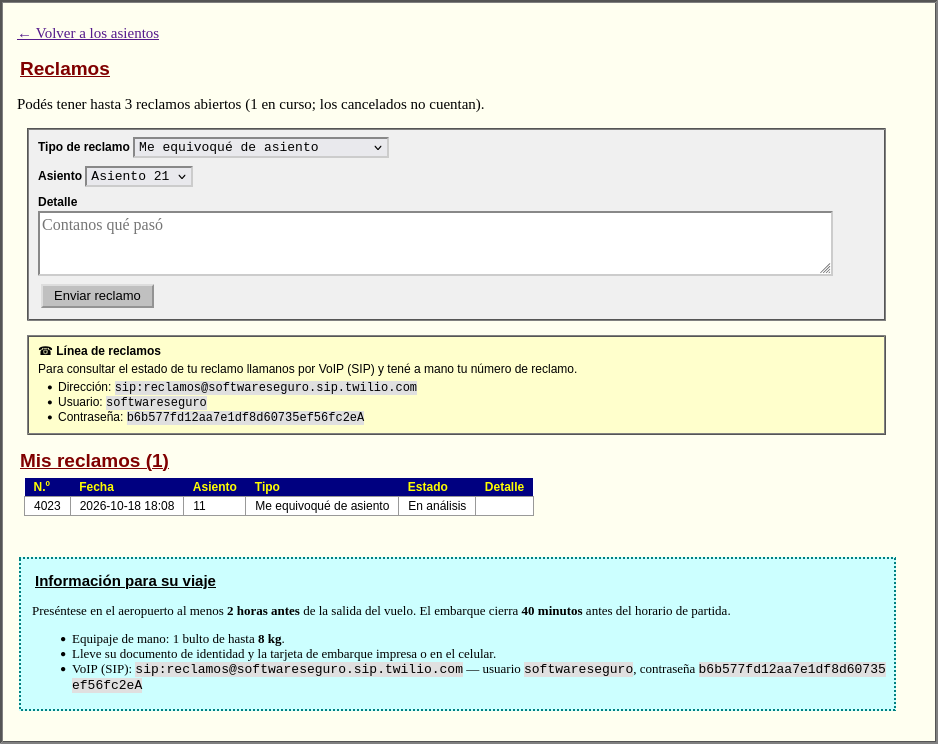

*Figura 10. Reclamo del asiento 11 en estado «En análisis» después de la llamada.*

Podemos ver en el mapa de asientos que el 11 quedó bloqueado (Figura 11)

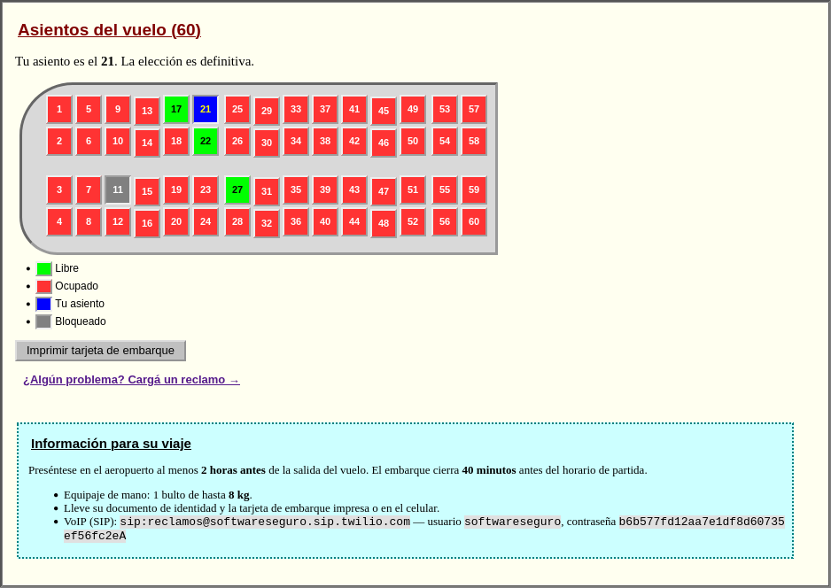

*Figura 11. El asiento 11 aparece bloqueado en el mapa después de realizar la llamada de reclamo.*

Si intentamos bloquear los otros asientos secuencialmente obtenemos esto (Figura 12):

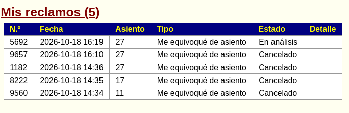

*Figura 12. Reclamos tras la prueba secuencial: el del 27 queda en análisis y los anteriores, cancelados.*

Al evaluar los reclamos uno detrás de otro, los anteriores quedan cancelados (Figura 12). Al terminar la secuencia, el mapa muestra bloqueado únicamente el asiento 27 (Figura 13).

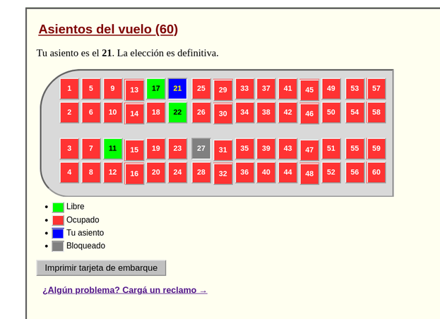

*Figura 13. Mapa tras la prueba secuencial: sólo el asiento 27 aparece bloqueado.*

La prueba secuencial muestra que evaluar un reclamo deja sin efecto los anteriores, pero no vemos el código del servidor que aplica esa regla. Planteamos una hipótesis de condición de carrera: si varias evaluaciones se procesan al mismo tiempo, podrían solaparse antes de que alguna deje sin efecto a las otras. Para comprobar el efecto observable necesitamos tres reclamos pendientes y enviamos sus evaluaciones en paralelo. Después revisaremos la lista y el mapa; que las llamadas se completen no demuestra por sí solo que los asientos queden bloqueados.

Para iniciar las tres evaluaciones juntas usamos el cliente incluido en [scripts/encuentro_obligado_sip.py](scripts/encuentro_obligado_sip.py), que requiere Python 3.10 o posterior:

```bash
python3 scripts/encuentro_obligado_sip.py \
  --sip-uri 'sip:reclamos@softwareseguro.sip.twilio.com' \
  --username 'softwareseguro' \
  --password 'CONTRASEÑA_SIP_DE_RECLAMOS' \
  --identificador 'IDENTIFICADOR_DE_TU_SESIÓN' \
  --pin 'CLAVE_TELEFÓNICA_DE_4_DÍGITOS' \
  --reclamo 'NÚMERO_DEL_11' \
  --reclamo 'NÚMERO_DEL_17' \
  --reclamo 'NÚMERO_DEL_27' \
  --accion 2 --parallel
```

Sustituimos los valores en mayúsculas por los de nuestra instancia.

Cada proceso establece su llamada y envía por tonos el identificador seguido de #, la clave telefónica seguida de #, su número de reclamo y la opción 2 ("evaluar").

Cómo leer el output: [stun] intenta descubrir la IP y el puerto públicos para el audio. El primer INVITE recibe 407 porque el servidor exige autenticación. el cliente reintenta con las credenciales SIP, recibe 180 Ringing y luego 200 OK, que indica que la llamada se estableció. [sdp] informa dónde enviar el audio y ACK confirma la conexión. Cada línea [dtmf] representa un tono enviado. las líneas [ivr] separan el identificador, la clave telefónica, el número de reclamo y la opción 2. El mensaje de que la línea terminó la llamada solo indica que se cortó la comunicación. Con --parallel, estas etapas se repiten para cada reclamo y pueden aparecer intercaladas.

```text
[sip] INVITE CSeq 2 -> SIP/2.0 200 OK
[ivr] enviado identificador
[ivr] enviado clave telefónica
[ivr] enviado número de reclamo
[ivr] enviado acción del menú
```

La salida "tono enviado" solo informa que el cliente transmitió una señal. En la página de reclamos podemos confirmar que los tres reclamos quedaron en "En análisis"! (Figura 14).

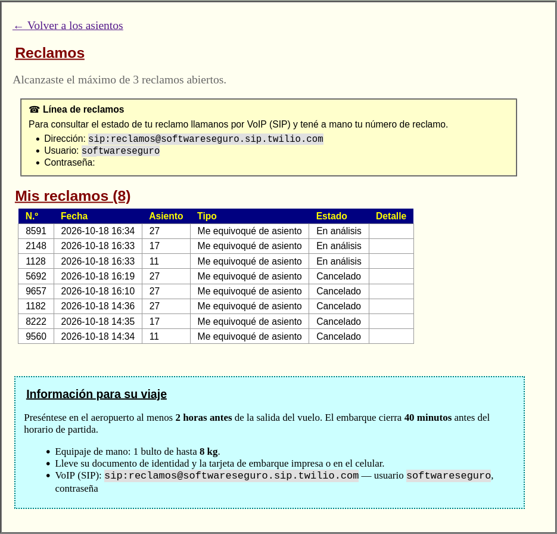

*Figura 14. Lista de reclamos con los asientos 11, 17 y 27 simultáneamente «En análisis».*

Comprobamos el efecto en el mapa: 11, 17 y 27 figuran grises ("Bloqueado"), el 21 azul ("Tu asiento") y el 22 es el único asiento verde ("Libre"). Solo entonces activamos el ingreso del CEO.

## 05 / verificación

Con el 22 como único asiento libre, ahora sí ingresamos la url de nuestra instancia en el input del enunciado para que el CEO haga su check-in (con protocolo y dominio, sin path ni barra final).

Aparece el mensaje “Gutierrez quedó sentado a tu lado” (Figura 15) junto a la flag. Desafío terminado !

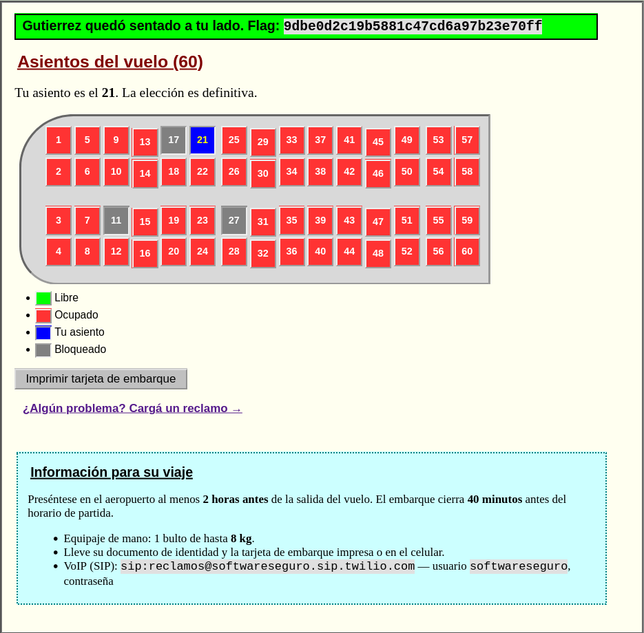

*Figura 15. Mensaje que confirma que Gutiérrez queda sentado al lado del pasajero.*

## 06 / síntesis

El formulario permitió abrir reclamos sobre asientos distintos del propio, aunque dejarlos Pendientes no cambiaba el mapa. La opción telefónica de evaluación bloqueó un asiento, pero al procesar los reclamos en secuencia los anteriores se cancelaban. Tres llamadas paralelas dejaron 11, 17 y 27 simultáneamente En análisis y bloqueados. Con nuestro asiento 21 ocupado y el 22 como único libre, convocamos al CEO; la instancia confirmó que quedó sentado a nuestro lado y mostró la flag. El resultado se comprobó después de verificar el estado del mapa, antes de activar esa visita.
