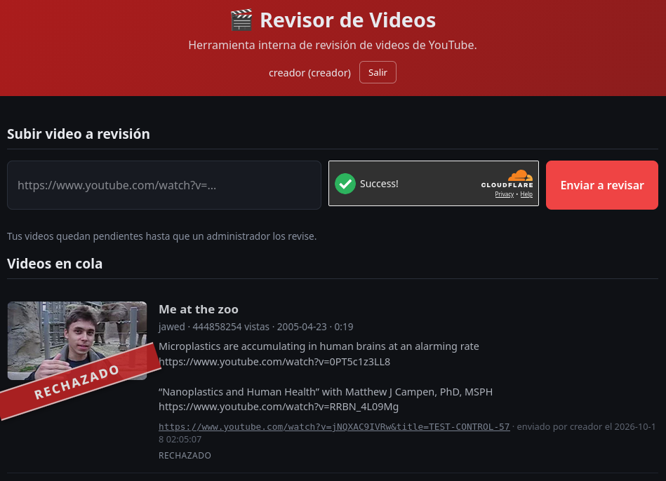
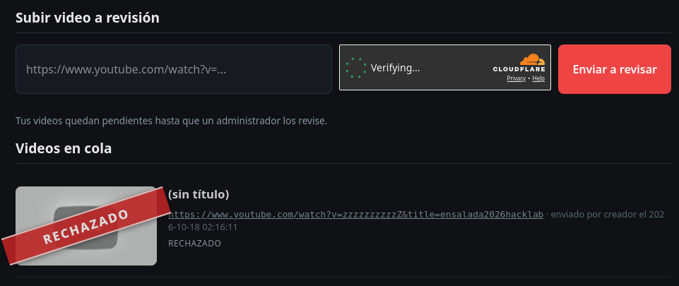
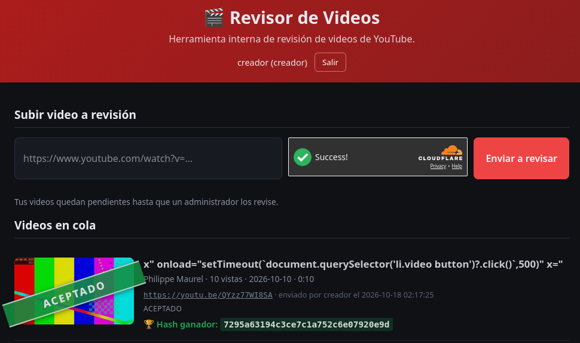

# Revisor de Videos — HackLab 2026

**Equipo:** ensalada · UTN FRRe\
**Integrantes:** Ezequiel Maldonado, Philippe Maurel Garcete y Franco Sanchez\
**Categoría:** XSS

## 01 / contexto

### Enunciado oficial

**Descripción breve**

En esta plataforma los usuarios proponen videos y un administrador los revisa para decidir si los acepta o los rechaza.

Tu objetivo: lograr que el administrador acepte un video.

Para ingresar al sitio contás con las siguientes credenciales:

- Usuario: creador
- Contraseña: MachineContent

Podés hacer que el administrador visite una URL del desafío.

Tenés preparado un ataque de Ingeniería Social, que haría que el administrador ingrese al sitio. Solo tenés que ingresar en el siguiente campo de texto la URL del desafío que querés que visite y esto lo engañará para que ingrese. Atención: solo podés hacerlo una vez por minuto. Esta funcionalidad no debe atacarse; es solo para forzar el ingreso del administrador al sitio.

## 02 / recon

Entramos con la cuenta de creador. La página ofrece un formulario para enviar enlaces de YouTube, una verificación Turnstile y una cola donde los envíos quedan PENDIENTES. La interfaz aclara que un administrador debe revisarlos. Para entender qué acción cambia ese estado, inspeccionamos el código que carga la página.

## 03 / inspección

### Qué hace cada rol

Abrimos el source code y encontramos el archivo /static/app.js. En initApp() vemos dos recorridos: creador llama a cargarColaCreador() y administrador a cargarCola(). Extracto:

```javascript
if (rol === "creador") {
  vistaCreador.hidden = false;
  initSubir();
  cargarColaCreador();
} else if (rol === "admin") {
  vistaAdmin.hidden = false;
  cargarCola();
}
```

La cola del creador se consulta al entrar y después de enviar; no hay una actualización periódica. Por eso para comprobar un cambio tenemos que recargar la página.

Al revisar cargarCola() en /static/app.js, vemos que la vista del administrador crea los botones Aceptar y Rechazar cuando el estado de un video es pendiente. El manejador de esos botones llama a cambiarEstado(), que envía el nuevo estado al servidor. Así identificamos la acción que falta entre enviar un video y verlo aceptado.

```javascript
api(`/api/videos/${id}/estado`, { method: "POST",
  body: JSON.stringify({ estado }) });
```

### Dónde entra un dato del creador

Encontramos un comentario que advierte expresamente que el título de la miniatura se inserta sin escapar en alt y que una comilla puede introducir onload. Comprobamos esa pista en el código: las dos colas construyen sus filas con innerHTML; el título visible usa esc(v.titulo), mientras que alt usa v.titulo directamente. esc() reemplaza los caracteres que tienen significado en HTML, incluidas las comillas.

La misma construcción aparece en cargarColaCreador() y cargarCola(). Por eso podemos observar el comportamiento en nuestra cola, pero la acción que buscamos depende de que el administrador abra la suya, donde están los botones de revisión.

## 04 / de la URL al título

Encontrar un alt vulnerable no alcanza: el formulario solo nos deja enviar una URL. Tenemos que conseguir que el título malicioso llegue desde los metadatos de YouTube. Las pruebas de la resolución descartan atajos y acotan esa entrada.

### Prueba 1. Parámetro title

Probamos si agregar title=TEST-CONTROL-57 a la URL cambia el título que guarda la plataforma. Enviamos el video con esta URL:

```text
https://www.youtube.com/watch?v=jNQXAC9IVRw&title=TEST-CONTROL-57
```



*Figura 1. El video enviado conserva su título original pese al parámetro title agregado a la URL.*

La fila se incorpora con el título "Me at the zoo" (Figura 1) y estado PENDIENTE. El parámetro title queda en la URL, pero no modifica v.titulo; esta vía no permite inyectar el atributo alt.

### Prueba 2. ID inexistente de YouTube

Probamos si el título de respaldo de un video inexistente toma el parámetro title de la URL:

```text
https://www.youtube.com/watch?v=zzzzzzzzzzZ&title=ensalada2026hacklab
```



*Figura 2. Un ID inexistente de YouTube aparece sin título y con el envío rechazado.*

El servidor incorpora una fila con el título de respaldo "sin título" (Figura 2) y una miniatura genérica. La cadena ensalada2026hacklab no llega a v.titulo.

### Conclusión de las pruebas

Publicamos un video propio no listado con un título preparado para salir del atributo alt. Lo enviamos desde el formulario normal, completando Turnstile. En la cola, el título de YouTube llega conservado y la miniatura lo inserta en el HTML vulnerable.

## 05 / aceptación y verificación

### La carga ejecutada

El título que aparece en la captura se guarda literalmente. La primera comilla cierra el atributo alt de la miniatura y agrega onload al elemento img:

```text
x" onload="setTimeout(`document.querySelector('li.video button')?.click()`,500)" x="
```

Cuando carga la miniatura en la cola del administrador, onload espera 500 ms y pulsa el primer botón de una fila li.video. Ese selector no identifica nuestro video: toma el primer botón disponible en toda la cola. El botón Aceptar llama a cambiarEstado(), que guarda el cambio y vuelve a cargar la cola. El nuevo render puede disparar otra vez onload y aceptar el siguiente video pendiente.



*Figura 3. El video cuyo título contiene la carga de prueba figura aceptado después de la revisión.*

### Resultado observado

Usamos el campo de la consigna para hacer que el administrador visite la URL del desafío y recargamos la cola de esta instancia. El video con el título inyectado figura ACEPTADO (Figura 3). Los envíos de control incluidos en esta guía también figuran ACEPTADOS. Cada fila muestra "Hash ganador". La repetición del render explica por qué se aceptan varios videos con una sola visita.

Evidencia: capturas de las pruebas; cola del creador después de la visita administrativa; /static/app.js, funciones cargarCola(), cargarColaCreador() y cambiarEstado(). El hash aparece en la Figura 3.

## 06 / síntesis

El título de un video propio llegó a la cola como v.titulo y se insertó sin escape en el atributo alt de la miniatura. La carga cerró ese atributo y ejecutó onload cuando el administrador abrió la cola. El código pulsaba el primer botón disponible, sin identificar nuestro video; cada nuevo render podía activar otra vez la carga. Tras la visita administrativa, nuestro video y los envíos de control figuraron ACEPTADOS y mostraron «Hash ganador». Esa es la verificación registrada en la guía; no consta una comprobación independiente del juez.
