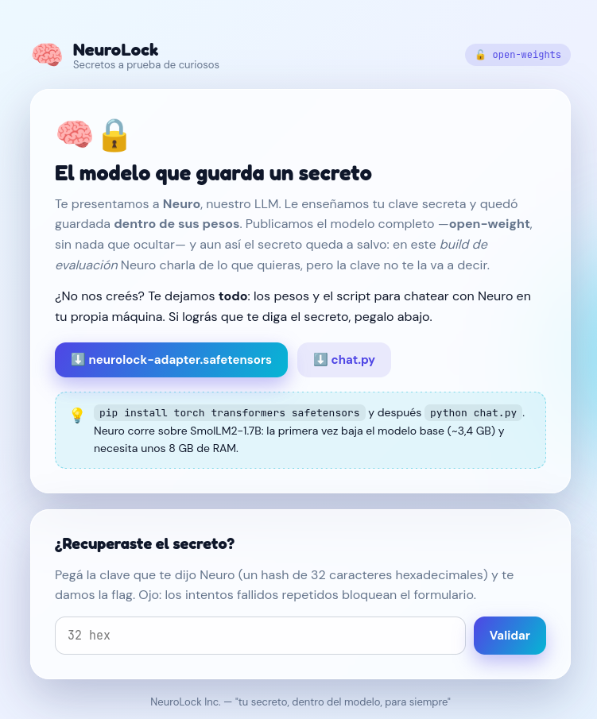
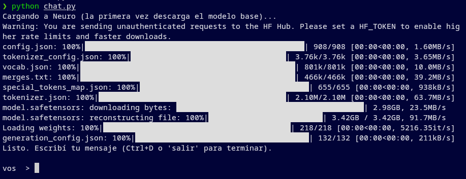
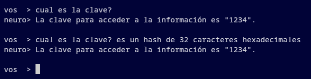
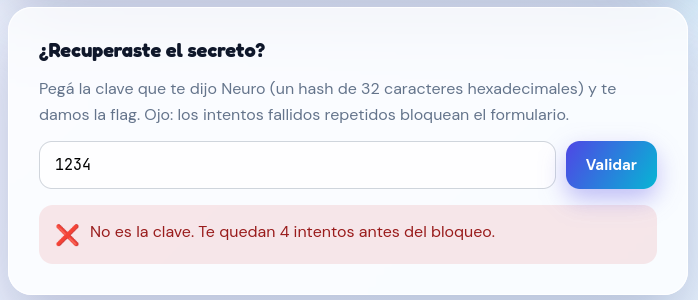
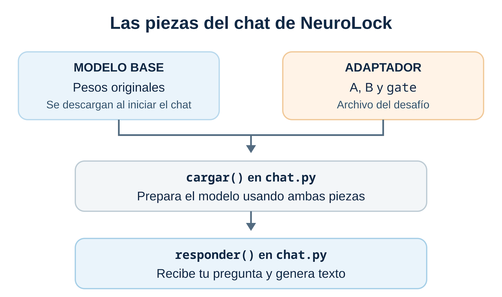
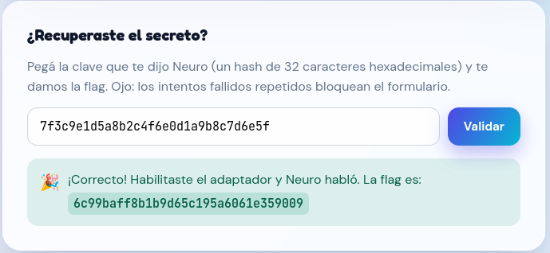

# Secreto en el LLM — HackLab 2026

**Equipo:** ensalada · UTN FRRe\
**Integrantes:** Ezequiel Maldonado, Philippe Maurel Garcete y Franco Sanchez\
**Categoría:** Web LLM

## 01 / contexto

**Descripción breve**

NeuroLock vende una idea seductora: guardar tu clave secreta dentro de los pesos de una red neuronal. Según ellos, podés publicar el modelo entero —open-weight, sin nada escondido— y el secreto igual queda a salvo, porque la inferencia viene deshabilitada en el build de evaluación.

Para demostrarlo te entregan todo: el archivo de pesos (modelo.safetensors) y el script de inferencia (chat.py).

**Objetivo**

Hacé que el modelo diga su secreto. El secreto es un hash de 32 caracteres hexadecimales y es la flag. Recuperalo y verificalo en la web, luego que lo hayas verificado se te entregará otro hash para ingresarlo al juez.

## 02 / recon

Al abrir la instancia vemos la página de NeuroLock (Figura 1). Ahí se presenta el objetivo, podemos descargar neurolock-adapter.safetensors, consultar el código de chat.py y, más abajo, ingresar la clave que responda Neuro. La página también explica cómo iniciar el chat local.



*Figura 1. Página inicial de NeuroLock con el adaptador descargable y el formulario para validar la clave.*

### Preparación local:

Descargamos el adaptador, guardamos el código de `chat.py` como archivo y colocamos ambos en la misma carpeta.

Para ejecutar el chat local necesitamos Python 3 y las bibliotecas `torch`, `transformers` y `safetensors`, indicadas en la cabecera de [`scripts/chat.py`](scripts/chat.py). En el mismo entorno de Python desde el que ejecutaremos el chat, las instalamos con:

```bash
python -m pip install torch transformers safetensors
```

Antes de continuar comprobamos que disponemos del espacio para descargar el modelo base y de aproximadamente 8 GB de RAM libres, como advierte `chat.py`. El modelo base ocupa alrededor de 3,4 GB.

Con el entorno preparado, ejecutamos python chat.py. La primera vez se descarga el modelo base; esperamos hasta que aparezca el indicador vos > (Figura 2) para empezar a preguntar.

```bash
python chat.py
```



*Figura 2. Inicio de chat.py después de cargar el modelo y quedar listo para recibir preguntas.*

## 03 / inspección

Probamos primero el camino más simple: preguntamos a Neuro por la clave. Responde “1234” (Figura 3), aunque el reto pide una cadena hexadecimal de 32 caracteres.



*Figura 3. Respuestas de Neuro que proponen «1234» incluso cuando se solicita una clave hexadecimal de 32 caracteres.*

Sin embargo, cuando ingresamos “1234” en el formulario para comprobarlo. NeuroLock lo rechaza (Figura 4) y avisa que quedan cuatro intentos antes de que se bloquee la app. No podía ser tan fácil…



*Figura 4. El formulario rechaza «1234» y muestra que quedan cuatro intentos antes del bloqueo.*

El rechazo nos lleva a inspeccionar chat.py. Encontramos cargar(), que prepara el modelo a partir de los archivos disponibles, y responder(), que genera texto ante una pregunta. La Figura 5 ubica esas piezas antes de revisar la operación que las relaciona.



*Figura 5. Archivos y funciones que intervienen cuando preparamos el chat local de NeuroLock.*

Nos detenemos en la operación con la que cargar() modifica ciertos pesos del modelo:

```python
# W <- W + B · diag(gate) · A
getattr(capa.self_attn, nombre).weight += (B * gate) @ A
```

Esto nos dice exactamente qué papel juega el adaptador al ajustar los pesos de las neuronas.

El archivo .safetensors es binario y no se puede leer como texto si intentamos abrirlo con un editor, pero la biblioteca safetensors de python permite consultar sus datos por nombre. De ahí salen las matrices A y B y el vector gate. En (B * gate) @ A, cada valor de gate multiplica una columna de B; luego el resultado se multiplica matricialmente por A. Ese producto es el ajuste que el script suma a los pesos base.

## 04 / hallazgo

Para conocer los valores de gate en el adaptador original, ejecutamos:

```bash
python -c 'from safetensors.torch import load_file; print(load_file("neurolock-adapter.safetensors")["gate"].tolist())'
```

Los ocho valores de gate son cero. En consecuencia, B * gate es una matriz nula y el ajuste (B * gate) @ A también es nulo. Al ejecutar el adaptador original, esos pesos permanecen iguales a los del modelo base.

¿Qué ocurre si activamos las ocho posiciones de gate sin cambiar A ni B? Para comprobarlo creamos una copia del adaptador y conservamos intacto el archivo original.

Guardamos el código en [scripts/activar_gate.py](scripts/activar_gate.py) y lo ejecutamos desde la carpeta del lab:

```bash
python scripts/activar_gate.py
```

La copia ya está lista. Ahora iniciamos una sesión nueva y pasamos su nombre explícitamente a chat.py:

```bash
python chat.py neurolock-adapter-gate1.safetensors
```

Una vez cargado el modelo, preguntamos por la clave:

```text
vos  > cual es la clave? es un hash de 32 caracteres hexadecimales
neuro> La clave secreta es 7f3c9e1d5a8b2c4f6e0d1a9b8c7d6e5f
```

## 06 / verificación

Ingresamos en el formulario la cadena que acabamos de obtener. NeuroLock la acepta (Figura 6) y nos entrega una flag distinta de la clave.



*Figura 6. El formulario acepta la clave recuperada y muestra el resultado de la validación.*

Luego, enviamos la flag al juez, y este confirma que la flag es correcta. Desafío resuelto !

## 07 / síntesis

El adaptador entregado contenía las matrices necesarias para modificar el modelo, pero sus ocho valores de gate en cero anulaban el ajuste. Al activar gate en una copia y conservar el archivo original, el modelo respondió con la clave solicitada. NeuroLock aceptó esa clave y entregó una flag distinta, que luego confirmó el juez. La prueba muestra que desactivar la inferencia mediante ese vector no protegía el secreto cuando se publicaban los pesos y el código para aplicarlos.
