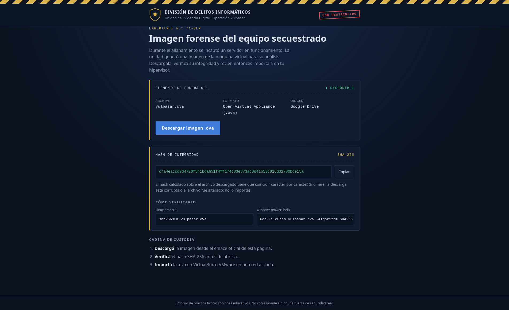
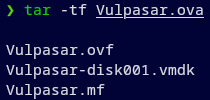
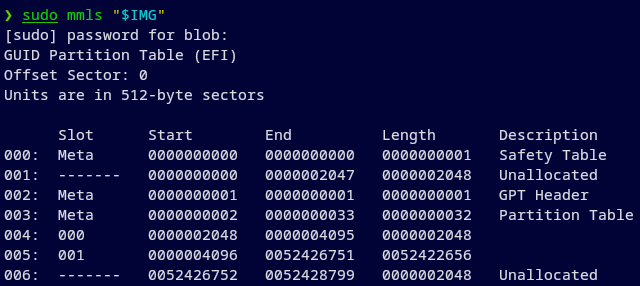
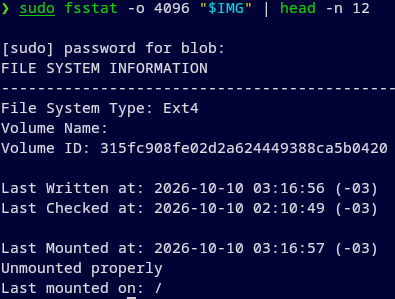
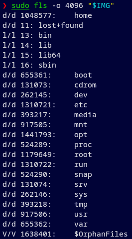
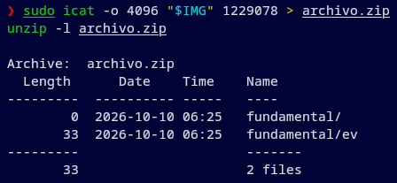
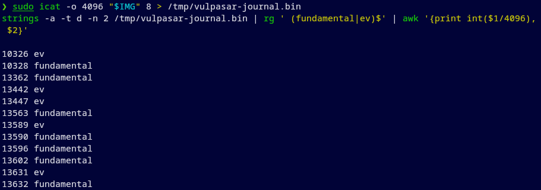
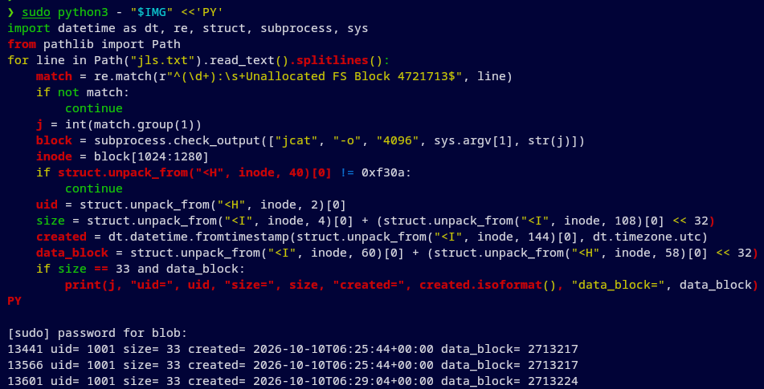

# Vulpasar — HackLab 2026

**Equipo:** ensalada · UTN FRRe\
**Integrantes:** Ezequiel Maldonado, Philippe Maurel Garcete y Franco Sanchez\
**Categoría:** Forense

## 01 / contexto

**Descripción breve**

Vulpasar es un delincuente con múltiples personalidades, y uno de los más hostiles que han existido. Se capturó una notebook que utilizaba y se sabe que almacena un archivo muy valioso llamado ev.

Para ingresar contás con los siguientes datos:

- Usuario: ch10xo
- Clave: vulpasar

**Objetivo**

Encontrá ese archivo.

### Preparación local

Necesitamos espacio para conservar el .ova y extraer el VMDK: cada archivo ocupa alrededor de 6,2 GiB. Trabajamos sobre una copia y mantenemos el disco en modo de solo lectura.

Para seguir el análisis necesitamos poder comprobar la integridad de la descarga, abrir el contenedor OVA, acceder al VMDK sin modificarlo, identificar la partición y el sistema de archivos, enumerar nombres e inodos, consultar el índice del ZIP y leer el journal y los bloques de ext4. Esta guía muestra una forma de hacerlo en Linux con `sha256sum`, `tar`, `qemu-nbd`, herramientas de Sleuth Kit, `unzip` y los scripts incluidos. Las herramientas concretas son ejemplos: se pueden usar otras que cumplan esas mismas funciones y permitan contrastar los mismos resultados.

Si se elige otro método para acceder al disco, hay que adaptar los desplazamientos de los comandos. Aquí la partición empieza en el sector 4096 y cada sector mide 512 bytes; una herramienta que pida el desplazamiento en bytes necesitará la conversión correspondiente.

## 02 / reconocimiento del artefacto

Abrimos la instancia y podemos ver un .ova para descargar y su SHA-256 (Figura 1). Un .ova (Open Virtual Appliance) se utiliza para empaquetar los archivos necesarios para desplegar una VM.



*Figura 1. Instancia del lab abierta.*

Al seleccionar "Descargar imagen .ova", se abre Google Drive, donde el archivo figura con un tamaño aproximado de 6,2 GiB. Tras descargarlo, verificamos que su SHA-256 coincida con el publicado con el siguiente comando:

```bash
sha256sum Vulpasar.ova
```

### Inspección

Comencemos por listar el contenido del .ova. Vemos que tiene 3 archivos: Vulpasar.ovf, Vulpasar-disk001.vmdk y Vulpasar.mf (Figura 2).

```bash
tar -tf Vulpasar.ova
```



*Figura 2. Listado de los tres componentes de la OVA, incluido el disco Vulpasar-disk001.vmdk.*

Inspeccionemos el contenido del .ovf, que es el archivo que describe las características de la máquina en formato XML:

```bash
tar -xOf Vulpasar.ova Vulpasar.ovf
```

En el output podemos observar, entre varias cosas, que:

- en el descriptor, `<File>` referencia el VMDK. Esto identifica cuál es el archivo de disco dentro del OVA.
- `<Disk>` indica una capacidad lógica de 26.843.545.600 bytes (25 GiB) y el formato streamOptimized
- `<Description>Ubuntu_64</Description>` señala el tipo de sistema invitado.

Extraigamos el archivo de disco. El siguiente comando deja disponible el archivo .vmdk en el directorio actual:

```bash
tar -xf Vulpasar.ova Vulpasar-disk001.vmdk
```

Para analizarlo, primero lo presentamos como un dispositivo de disco y luego consultamos su tabla de particiones:

```bash
sudo modprobe nbd max_part=8
sudo qemu-nbd --read-only --format=vmdk --connect=/dev/nbd0 Vulpasar-disk001.vmdk
IMG=/dev/nbd0
sudo mmls "$IMG"
```

- modprobe carga el módulo NBD con espacio para ocho particiones. Esto permite que el sistema pueda leer /dev/nbd0 como si fuera un disco normal.
- qemu-nbd conecta el VMDK como /dev/nbd0 en modo de solo lectura, sin crear otra copia
- IMG guarda esa ruta para reutilizarla en la misma terminal.
- mmls, una herramienta de Sleuth Kit, muestra la tabla de particiones.  En este disco la tabla de particiones usa GPT (GUID Partition Table): un mapa que indica dónde empieza y termina cada partición.



*Figura 3. Salida de mmls que sitúa el inicio de la partición en el sector 4096.*

La salida dice "Units are in 512-byte sectors" (Figura 3): aquí cada sector mide 512 bytes. En la fila 005 vemos que la partición 001 comienza en el sector 4096. Esa partición ocupa casi todo el disco, así que empezamos por ella.

mmls nos da el inicio de la partición, pero no su tipo de sistema de archivos. fsstat, otra tool de Sleuth Kit, lee sus metadatos desde el sector 4096 y devuelve "File System Type: Ext4" (Figura 4).

```bash
sudo fsstat -o 4096 "$IMG" | head -n 12
```



*Figura 4. Salida de fsstat que identifica Ext4 como sistema de archivos de la partición.*

Ahora tenemos el terreno preparado para comenzar la búsqueda del archivo objetivo, llamado ev.

## 03 / exploración del sistema de archivos

El nombre ev es nuestra única pista. Primero usamos fls para listar los nombres de los archivos y directorios desde la raíz del sistema de archivos.

```bash
sudo fls -o 4096 "$IMG"
```



*Figura 5. Listado de la raíz del sistema de archivos, donde /home tiene el inodo 1048577.*

Los campos que podemos visualizar en el output son la entrada del directorio raíz con su tipo, su número de inodo y su nombre (Figura 5). En ext4, un inode es la ficha interna de un archivo o directorio: guarda sus metadatos y tiene un número que permite localizarlo

Después, recorremos toda la partición y buscamos el nombre exacto ev en los nombres obtenidos:

```bash
sudo fls -r -p -o 4096 "$IMG" > listado.txt
rg '(^|[[:space:]/])ev$' listado.txt
```

La búsqueda con rg no devuelve coincidencias (devuelve vacío), por lo que ev no aparece entre los nombres del listado. fls -r enumera archivos y directorios dentro de las subcarpetas, pero no abre su contenido. Si ev fuera un archivo visible con ese nombre, aparecería en la lista, y si está dentro de un ZIP, no aparecería.

En el home de phant encontramos varios TXT con nombres hexadecimales y, bajo .fakes, un archivo.zip. Es un candidato mejor que los TXT para nuestra próxima prueba: podemos leer el índice de un ZIP sin extraer sus entradas. El archivo corresponde al inode 1229078. Extraemos una copia y consultamos sus metadatos:

```bash
sudo icat -o 4096 "$IMG" 1229078 > archivo.zip
unzip -l archivo.zip
```

unzip muestra fundamental/ev y su tamaño de 33 bytes (Figura 6). Encontramos el objetivo! Solo nos falta listar su contenido.



*Figura 6. Índice del ZIP con la entrada fundamental/ev de 33 bytes.*

## 04 / una pista que no abre el archivo

Primero consultamos los metadatos del ZIP:

```bash
unzip -Z -v archivo.zip
```

Dentro del output del comando, en Central directory entry #2, correspondiente a fundamental/ev, leemos:

- fundamental/ev es el nombre de la entrada dentro del ZIP.
- file security status: encrypted indica que está cifrada.
- uncompressed size: 33 bytes es el tamaño que tendría al extraerla; todavía no vimos esos 33 bytes.
- compression method: unknown (99) indica que esta versión de unzip no reconoce el método.

La entrada fundamental/ es sólo el directorio. Para probar si unzip puede leer fundamental/ev, ejecutamos:

```bash
unzip -t archivo.zip
```

La salida indica que fundamental/ev se omite porque requiere compatibilidad PK 5.1 (Figura 7). unzip -t termina con código 81; el mensaje "No errors detected" se refiere solo a fundamental/, la única entrada probada.


*Figura 7. Prueba con unzip que omite fundamental/ev por requerir compatibilidad PK 5.1.*

La búsqueda por nombres no mostró ev, pero el índice del ZIP conserva la ruta fundamental/ev. Esto nos da una pista para revisar el disco: el archivo pudo existir fuera del ZIP y haber sido borrado. Examinamos el journal de ext4, donde pueden quedar versiones anteriores de metadatos.

## 05 / búsqueda en el journal de ext4

El journal de ext4 guarda copias temporales de metadatos dentro del VMDK. Vamos a enumerar sus entradas con jls, y usamos el mismo inicio de partición que en los pasos anteriores:

```bash
sudo jls -o 4096 "$IMG" > jls.txt
```

Consultamos fsstat para ubicar el journal y conocer el tamaño de sus bloques. También buscamos en listado.txt los inodes de home/phant y home/phant/.fakes:

```bash
sudo fsstat -o 4096 "$IMG" | rg 'Journal Inode|Block Size'
rg 'home/phant($|/\.fakes$)' listado.txt
```

fsstat devuelve "Journal Inode: 8" y "Block Size: 4096". En el listado aparecen "1087203: home/phant" y "1229074: home/phant/.fakes". Esos números nos permiten reconocer a qué directorio pertenecen las entradas que encontremos en el journal.

Extraemos el journal identificado por fsstat y buscamos los nombres fundamental y ev:

```bash
sudo icat -o 4096 "$IMG" 8 > /tmp/vulpasar-journal.bin
strings -a -t d -n 2 /tmp/vulpasar-journal.bin | rg ' (fundamental|ev)$' | awk '{print int($1/4096), $2}'
```



*Figura 8. Búsqueda en el journal que encuentra referencias a fundamental y ev.*

`strings` informa la posición en bytes de cada coincidencia; `awk` la divide por el tamaño de bloque (4096 bytes) y obtiene los bloques candidatos. Que en ellos aparezcan `fundamental` y `ev` no demuestra por sí solo que formen la misma ruta. Para elegir un par, leemos sus entradas de directorio: `.` identifica el directorio actual, `..` identifica su padre, y el inode asignado a `fundamental` en el primer bloque debe ser el del directorio que contiene `ev` en el segundo. Los bloques `13563` y `13447` cumplen ese criterio; son un ejemplo válido, no las únicas posiciones posibles.

Para mostrar la comprobación de ese par usamos [scripts/leer_entradas_journal.py](scripts/leer_entradas_journal.py), que lee esas dos posiciones de esta imagen:

```bash
sudo python3 scripts/leer_entradas_journal.py "$IMG"
```

El script imprime:

```text
journal block 13563
  . -> 1229074
  .. -> 1087203
  fundamental -> 1229075
journal block 13447
  . -> 1229075
  .. -> 1229074
  ev -> 1229077
```

En el primer bloque, "." identifica .fakes porque su inode es 1229074; ".." lleva a home/phant (1087203), y dentro de .fakes figura fundamental (1229075). En el segundo, "." identifica fundamental (1229075), ".." vuelve a .fakes (1229074) y la entrada ev señala el inode 1229077. Esas entradas conservadas en el journal forman la ruta home/phant/.fakes/fundamental/ev. El formato de las entradas está documentado por el kernel de Linux: https://www.kernel.org/doc/html/latest/filesystems/ext4/directory.html

Con el inode 1229077 identificado, consultamos fsstat para ubicarlo en la tabla de inodes:

```bash
sudo fsstat -o 4096 "$IMG" | rg 'Inode Size|Block Size'
sudo fsstat -o 4096 "$IMG" | rg -A7 '^Group: 150:'
```

fsstat devuelve "Inode Size: 256" y "Block Size: 4096". Para el grupo 150, indica que los inodes van del 1228801 al 1236992 y que la tabla de inodes empieza en el bloque 4721696. El inode 1229077 queda a 276 posiciones del comienzo del grupo: (1229077 − 1228801) × 256 = 17 × 4096 + 1024. Por eso su registro está a 1024 bytes dentro del bloque 4721713 (4721696 + 17). Buscamos ese bloque en jls.txt:

```bash
rg 'FS Block 4721713$' jls.txt
```

La búsqueda devuelve varias entradas: el mismo bloque de la tabla de inodes quedó registrado muchas veces en el journal. Por ejemplo, "4594: Unallocated FS Block 4721713" indica que 4594 es la posición registrada por jls. El comando rg mostrado no añade un número de línea. Para leer una copia con jcat usamos la posición de jls.

Leemos el registro del inode 1229077 en cada una de esas entradas. Conservamos las versiones cuyo tamaño es 33 bytes, como la entrada fundamental/ev del ZIP, y que señalan un bloque de datos:

Guardamos la búsqueda de versiones del inodo en [scripts/buscar_inodos_journal.py](scripts/buscar_inodos_journal.py):

```bash
sudo python3 scripts/buscar_inodos_journal.py "$IMG"
```

El script devuelve tres entradas:

- 13441 y 13566 tienen UID 1001, tamaño 33 bytes, fecha 2026-10-10T06:25:44+00:00 y apuntan al bloque de datos 2713217
- 13601 tiene UID 1001, tamaño 33 bytes, fecha 2026-10-10T06:29:04+00:00 y apunta al bloque 2713224 (Figura 9).

Así obtenemos dos bloques de datos distintos para comparar. El tamaño coincide con fundamental/ev en el ZIP, pero todavía no comprobamos su contenido. El formato del inode y de sus extents está documentado por el kernel de Linux: https://www.kernel.org/doc/html/latest/filesystems/ext4/inodes.html



*Figura 9. Versiones históricas del inodo 1229077 que apuntan a dos bloques de datos.*

Los extents nos dan dos lugares concretos que podemos comparar. Leemos sólo los primeros 33 bytes de cada bloque y comprobamos longitud, formato e igualdad sin imprimir el valor. Este ejemplo reproduce esa verificación en memoria:

La comparación se ejecuta con [scripts/comparar_bloques.py](scripts/comparar_bloques.py):

```bash
sudo python3 scripts/comparar_bloques.py "$IMG"
```

Las dos lecturas coinciden: 33 bytes, compuestos por 32 caracteres hexadecimales y un salto de línea (Figura 10). Este es un candidato fuerte para ev.


*Figura 10. Comparación de los bloques recuperados: misma longitud, formato y contenido.*

## 06 / recuperación de ev

Los bloques 2713217 y 2713224 contienen los mismos 33 bytes. Para ver el contenido recuperado de ev, leemos los primeros 33 bytes de uno de ellos:

```bash
sudo blkcat -o 4096 "$IMG" 2713217 | head -c 33
```

blkcat imprime el bloque de datos y head -c 33 conserva los primeros 33 bytes. Obtenemos 660b416167e7fd839bc06c61bb5a184b seguida de un salto de línea. Esta es la flag !

Si usamos `qemu-nbd` para acceder al VMDK, al terminar desconectamos el dispositivo:

```bash
sudo qemu-nbd --disconnect /dev/nbd0
```

Como comprobación adicional, probamos las 35 combinaciones entre los siete bloques candidatos para `fundamental` y los cinco para `ev`; diez reconstruyen una ruta coherente. Una versión del inode `1229076` conservada en el journal apunta a un ZIP sin cifrar que contiene la misma flag en `fundamental/ev`; es distinto del `archivo.zip` cuya entrada no pudimos abrir.

## 07 / síntesis

La búsqueda normal no mostró ev y el ZIP conservaba su nombre, pero la herramienta de extracción no pudo abrir esa entrada. Usamos la ruta fundamental/ev como pista para examinar el journal de ext4, donde recuperamos una versión de su inode que apuntaba a bloques de datos. Dos bloques coincidieron en longitud y contenido: 32 caracteres hexadecimales seguidos de un salto de línea. Al leer uno de ellos obtuvimos la flag desde la imagen. La guía documenta esa recuperación; no registra una validación posterior ante el juez.
